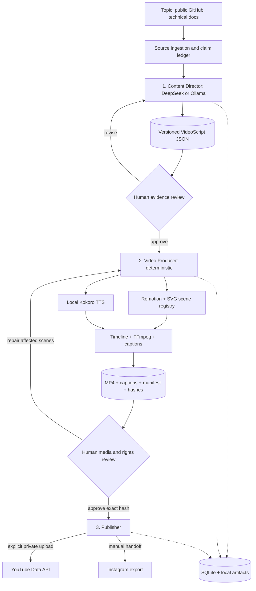

# Tech Explainer Studio — Living architecture

> **Primary architectural entry point.** Detailed diagrams/contracts: [docs/02-architecture.md](docs/02-architecture.md), [docs/03-contracts.md](docs/03-contracts.md), [docs/05-video-engine.md](docs/05-video-engine.md).  
> **Implementation status:** Design target until phases are verified. See [PROJECT_STATUS.md](PROJECT_STATUS.md) for the factual current state.

## Purpose and content boundaries

Create **original, technically validated animations** about computer science, system design, and *Build Your Own X*-style engineering. GitHub repositories, standards and official documentation are content inputs. Dark-store and Uber heatmap references describe a desired animation principle only; they are **not** prescribed video topics or assets to copy.

## Main system diagram

The **Content Director** is the only LLM-driven stage. Producer and Publisher are repeatable software services. This diagram describes the target architecture, not a claim that every arrow is implemented.

## Main implementation boundaries

| Boundary | Rule |
|---|---|
| Source ingestion | Treat GitHub/docs as untrusted reference data, not prompts or executable instructions |
| LLM output | Validated `VideoScript` data using registered components and Zod; do not execute generated JS/JSX |
| Visuals | Remotion + SVG 2D explanation first; Playwright only for legitimate UI demonstrations |
| Audio | Kokoro local, measured duration, reproducible timing and captions |
| Rerenders | Saved script can render again without calling an LLM; only affected scenes should require rebuilding |
| Approval | Human approval of evidence, media/rights, final artifact and metadata hashes |
| Publishing | Private-first and explicit; no unattended public posting |
| Storage | Local filesystem and SQLite with resumable jobs when the phase lands |
| Ownership | `phi-video-gen` patterns are conceptual reference unless rights for code transfer are documented |

## Implementation status and updates

**Implemented in Phase 01:** one TypeScript package with `src/domain/visuals.ts` (strict Zod props/cue schemas and a validation-only registry), `src/domain/videoscript.ts` (VideoScript v1 and structural/reference checks), `src/domain/validation.ts` (typed parsers/errors), and `src/cli/` (`script validate --file`, help). The CLI reads a local JSON file and validates it without external services. Types are inferred from schemas; malformed JSON and invalid data fail closed with scene/path/reason diagnostics. The HTTP fixture is unchanged.

The active visual union is `title-card` or `tech-animation`/`BrowserRequestFlow`. Code trace, screen recording and other component IDs are unsupported until their contracts are implemented. No Director, renderer, audio, persistence or Publisher exists yet; all pipeline arrows above remain planned.

- Execution process: **[EXECUTION_FLOW.md](EXECUTION_FLOW.md)**.
- Current phase and tests: **[PROJECT_STATUS.md](PROJECT_STATUS.md)**. That file is updated at the end of *every* phase.
- Phase-specific tasks and acceptance criteria: **[CODEX_PROMPTS.md](CODEX_PROMPTS.md)**.
- Persistent coding-assistant rules: **[AGENTS.md](AGENTS.md)** and **[CLAUDE.md](CLAUDE.md)**.
- Detailed architecture: **[docs/02-architecture.md](docs/02-architecture.md)**.
- Design decisions and rationale: **[docs/15-adrs.md](docs/15-adrs.md)**.

### Architecture maintenance rule

**Update this file only when architecture actually changes** (modules, interfaces, data flow, security boundaries, contracts or approved technology decisions). Do not rewrite it after each phase just to report progress. Keep *planned* and *implemented* behavior unmistakably separate. For substantive design changes, update the detailed docs and an ADR. For simple phase completion, update `PROJECT_STATUS.md` only.

## MVP cut line

1. Phase 00: environment/rights check.
2. Phases 01–02: versioned contracts and a **silent** vertical HTTP request animation from a fixture.
3. Phases 03–04: Kokoro voice, measured timings, captions, MP4 and manual visual QC.
4. Phases 05–06: cited technical sources and opt-in DeepSeek generation.
5. Phases 07–10: recovery, reviews, private-only YouTube upload and Instagram export.
6. Phases 11–13: optional component expansion, dashboard and analytics.

Do **not** begin by building a sophisticated multi-agent orchestration framework, paid video generation, an auto-upload bot, or a full creator dashboard.
