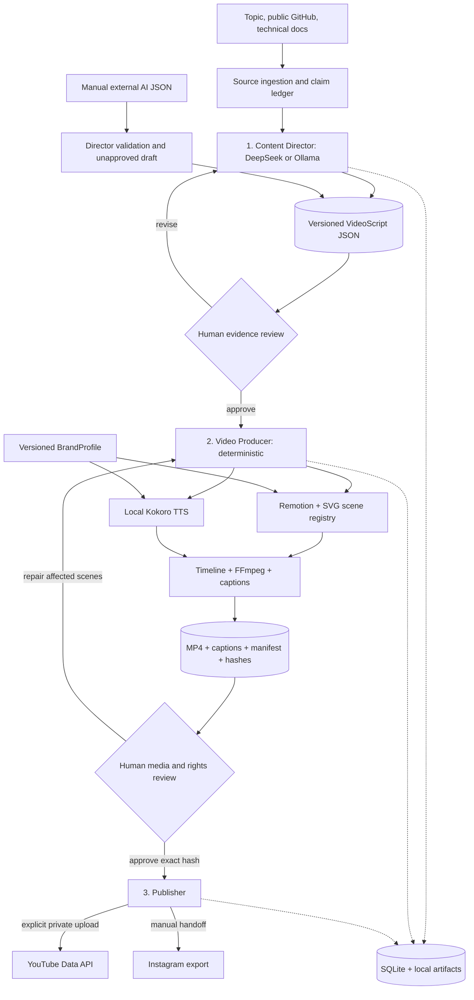

# Tech Explainer Studio — Living architecture

> **Primary architectural entry point.** Detailed diagrams/contracts: [docs/02-architecture.md](docs/02-architecture.md), [docs/03-contracts.md](docs/03-contracts.md), [docs/05-video-engine.md](docs/05-video-engine.md).  
> **Implementation status:** Design target until phases are verified. See [PROJECT_STATUS.md](PROJECT_STATUS.md) for the factual current state.

## Purpose and content boundaries

Create **original, technically validated animations** about computer science, system design, and *Build Your Own X*-style engineering. GitHub repositories, standards and official documentation are content inputs. Dark-store and Uber heatmap references describe a desired animation principle only; they are **not** prescribed video topics or assets to copy.

## Main system diagram

The **Content Director** is the only LLM-driven stage. Producer and Publisher are repeatable software services. This diagram describes the target architecture, not a claim that every arrow is implemented.

## Main implementation boundaries

| Boundary | Rule |
|---|---|
| Source ingestion | Treat GitHub/docs as untrusted reference data, not prompts or executable instructions |
| LLM output | Validated `VideoScript` data using registered components and Zod; do not execute generated JS/JSX |
| Visuals | Remotion + SVG 2D explanation first; Playwright only for legitimate UI demonstrations |
| Audio | Kokoro local, measured duration, reproducible timing and captions |
| Rerenders | Saved script can render again without calling an LLM; only affected scenes should require rebuilding |
| Approval | Human approval of evidence, media/rights, final artifact and metadata hashes |
| Publishing | Private-first and explicit; no unattended public posting |
| Storage | Local filesystem and SQLite with resumable jobs when the phase lands |
| Ownership | `phi-video-gen` patterns are conceptual reference unless rights for code transfer are documented |

## Implementation status and updates

**Implemented in Phase 01:** one TypeScript package with `src/domain/visuals.ts` (strict Zod props/cue schemas and a validation-only registry), `src/domain/videoscript.ts` (VideoScript v1 and structural/reference checks), `src/domain/validation.ts` (typed parsers/errors), and `src/cli/` (`script validate --file`, help). The CLI reads a local JSON file and validates it without external services. Types are inferred from schemas; malformed JSON and invalid data fail closed with scene/path/reason diagnostics. The HTTP fixture is unchanged.

**Implemented in Phase 02:** `src/renderers/remotion/` adds the silent timeline planner, local bundler/browser orchestration, static render registry, portrait composition, mobile text-bound/collision checks and FFmpeg/ffprobe QC. `src/visuals/` contains original SVG title/flow visuals and pure frame mapping. `render --script` dynamically loads this renderer; validation/help do not import Remotion. Rendering uses a local browser, locally bundled font and version-pinned platform binaries; it does not instantiate an LLM or fetch source URLs/assets. Outputs are unapproved silent previews with estimated timing, PNG evidence and hashed manifests. Narrated/audio-driven timing, caching and release gates remain future work.

**Implemented in Phase 03:** `src/audio/` exposes `NarrationProvider.health()` and `.synthesize({sceneId, text, outputDir})`. Local Kokoro ONNX runs through a fixed Python worker using JSON stdin and bounded, shell-free subprocess execution. Strict non-secret config in `src/config/narration.ts` identifies hashed local model/voice assets, versioned voice/lexicon settings, seeded inference and resource limits. Each scene retains a validated WAV, ffprobe duration and hash manifest; the explicit mock emits labeled test tones. `audio doctor`, `audio smoke` and `audio narrate` are separate from silent rendering. No model download or LLM is part of this path. See ADR-011 and the operations guide for runtime pins and limits.

**Implemented in Phase 04:** `src/timing/` resolves measured PCM samples plus authored minimum holds into a contiguous integer-frame timeline, captions and phrase-cue windows. The optional reviewed-word contract is bound to the exact WAV/narration hashes. An explicit scene speech-span fallback supports unapproved previews and blocks strict timing checks; it is not forced alignment. The existing Remotion composition consumes validated presentation frames and reserves a caption band. `src/media/` reads saved narration, assembles sample-exact padded audio, muxes H.264/AAC with bounded FFmpeg, probes the final video and independently decodes/checks every AAC scene. `src/render-manifest/` records artifact/source/tool/implementation hashes and review limitations. `render --narration` imports no narrator/LLM provider and grants no release approval. See ADR-012 for rounding, fallback and QC decisions.

**Implemented in Phase 05:** `src/sources/` provides explicit public-document ingestion, conservative URL/IP policy, all-answer DNS checks, address-pinned native HTTP(S), total deadlines and streamed byte limits. It follows only bounded approved-host redirects and stores strict minimal snapshots (body hash/provenance, at most 1200 characters of inert text, no raw page). Suspicious documents retain hash/provenance with no excerpt. License mentions never grant reuse. `src/claims/ledger.ts` initializes unreviewed claims, validates exact quote/snapshot-bound manual decisions and a separate hash-bound local fact approval, and exports only reviewed inert reference JSON. `source`/`claims` commands lazy-load these modules; validation/rendering never ingest sources or call an LLM. This is separate JSON persistence, not SQLite, Director automation or Phase 08 release approval. Detection is heuristic and reviewer names are local assertions; live ingestion was not exercised at the user's request. See ADR-013 and the executable evidence contracts.

**Phase 05 multi-source extension:** `src/sources/bundle.ts` validates a user-authored research brief and approved URL/pasted-text entries, then orchestrates the existing fetcher sequentially under aggregate count/byte/request/deadline limits. `research-source.ts` adds typed 1.1.0 provenance/selection contracts while legacy snapshots/digests remain unchanged. Every input maps to a deduplicated source ID; approval/policy differences never broaden redirect permissions. Manual text has no invented URL/revision and remains untrusted. Bundle-aware 1.1.0 claim ledgers bind the brief and bundle hash, support multiple claims/citations and block unresolved status/evidence issues. The inert context retains editorial instructions separately from evidence for the planned Director. No provider, crawler or dashboard is added. See README and the extended ADR-013 for limits and deduplication behavior.

**Implemented in Phase 06:** `src/director/` exports Zod-derived VideoScript schemas, the actual read-only catalog/producer constraints, prompts and approved brand; manual JSON import and optional model generation share one strict executable/evidence validator and unapproved draft persistence. Approved Phase 05 bundles/ledgers provide bounded inert evidence; exact source/claim bindings and existing human decisions are preserved. Manual legacy imports without provenance remain explicitly unapproved previews. A local hash-bound narration/storyboard review is distinct from future release approval. `src/llm/` supplies an interchangeable provider interface, explicit local mock and optional opt-in DeepSeek adapter with public pinned HTTPS, cancellation, byte/token/retry/repair limits and conservative estimated-spend reservation. No provider/key is loaded for normal rendering, import or export. DeepSeek was mock-tested only, not called live.

`src/branding/` consolidates existing production tokens and narration defaults in the versioned `tech-explainer@1.0.0` profile; existing explicit voice settings win. Remotion/theme/captions and narration config consume this profile, and producer manifests record its ID/version/hash. VideoScript 1.0.0 remains unchanged;1.1.0 adds a validated brand reference and explicit null URLs for pasted notes. No fake remote provenance or arbitrary generated style/code is accepted. Manual and automated drafts feed the same measured Producer; no new renderer, aligner, publisher or Phase 07 persistence system is added. See ADR-014, contracts and the brand audit.

The active visual union is `title-card` or `tech-animation`/`BrowserRequestFlow`. Code trace, screen recording and other component IDs are unsupported until their contracts are implemented. No autonomous research, automatic word aligner, durable job database or Publisher exists yet; the rest of the full-production pipeline above remains planned. Voice clarity and actual caption/phone playback acceptance remain human review items.

- Execution process: **[EXECUTION_FLOW.md](EXECUTION_FLOW.md)**.
- Current phase and tests: **[PROJECT_STATUS.md](PROJECT_STATUS.md)**. That file is updated at the end of *every* phase.
- Phase-specific tasks and acceptance criteria: **[CODEX_PROMPTS.md](CODEX_PROMPTS.md)**.
- Persistent coding-assistant rules: **[AGENTS.md](AGENTS.md)** and **[CLAUDE.md](CLAUDE.md)**.
- Detailed architecture: **[docs/02-architecture.md](docs/02-architecture.md)**.
- Design decisions and rationale: **[docs/15-adrs.md](docs/15-adrs.md)**.

### Architecture maintenance rule

**Update this file only when architecture actually changes** (modules, interfaces, data flow, security boundaries, contracts or approved technology decisions). Do not rewrite it after each phase just to report progress. Keep *planned* and *implemented* behavior unmistakably separate. For substantive design changes, update the detailed docs and an ADR. For simple phase completion, update `PROJECT_STATUS.md` only.

## MVP cut line

1. Phase 00: environment/rights check.
2. Phases 01–02: versioned contracts and a **silent** vertical HTTP request animation from a fixture.
3. Phases 03–04: Kokoro voice, measured timings, captions, MP4 and manual visual QC.
4. Phases 05–06: cited technical sources and opt-in DeepSeek generation.
5. Phases 07–10: recovery, reviews, private-only YouTube upload and Instagram export.
6. Phases 11–13: optional component expansion, dashboard and analytics.

Do **not** begin by building a sophisticated multi-agent orchestration framework, paid video generation, an auto-upload bot, or a full creator dashboard.
