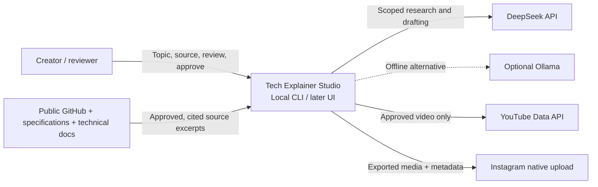
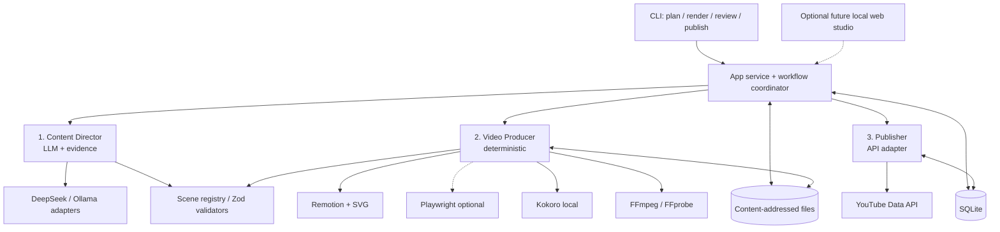
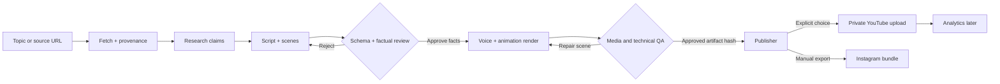
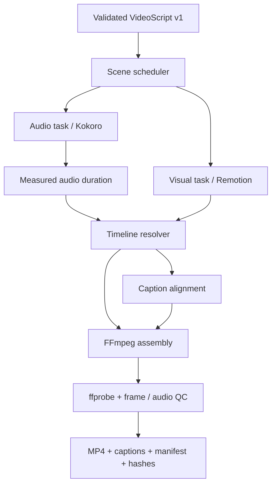
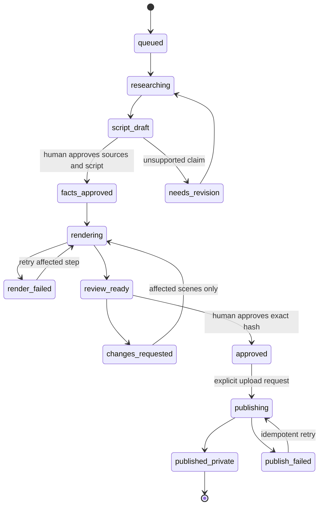

# 02 — Architecture and Mermaid diagrams

## 2.1 System context



**Trust boundary:** untrusted GitHub/web content is *reference data*, not instructions. Only user-confirmed sourced excerpts are sent to external AI providers; never send employer IP or secrets.

## 2.2 High-level containers



Three **roles**, not three autonomous always-on agents. The Director uses AI; Producer and Publisher are code services.

## 2.3 Pipeline and human gates



No transition from draft generation to a public video bypasses human quality approval. Gate checks are in application code, not merely prompt text.

## 2.4 Producer component flow



For **recorded UI scenes**, Playwright can run in a separate worker. Do not carry over the old constraint that a customer-facing video must show only live UI. Technical explainers should allow `tech-animation` in any scene position.

## 2.5 Persistent state machine



Public scheduling is **a separate explicit action** and not implied by a successful upload.

## 2.6 Proposed module organization

**Phase 01 foundation (retained):** one root TypeScript package, with `src/domain/` for Zod schemas and typed validation, `src/cli/` for local file validation/help, and `tests/` using Node's built-in test runner. `parseVideoScript(unknown)` and `parseVideoScriptJson(string)` return schema-inferred `VideoScriptV1` or throw `ScriptValidationError`. The domain component registry registers only the `BrowserRequestFlow` props schema and has no render function. Phase 01 introduced no API server, rendering, persistence or external integration; the Phase 02 extension below adds silent rendering.

**Phase 02 extension:** the same package now includes `src/visuals/` (original SVG flow/state/text components) and `src/renderers/remotion/` (silent planning, explicit renderer registry, composition, local browser/bundler orchestration, media tools/QC). The domain registry remains schema-only, keeping validation independent; a separate static render registry binds the approved ID to authored React code. `render --script` lazy-loads `render-cli.ts`; no LLM code or generated expressions are imported. Remotion's ephemeral asset server binds to loopback. Existing local Chrome is required, and font assets and FFmpeg/ffprobe are resolved from pinned dependencies. No browser/model download, API server, database or external integration is added. Render manifests describe **unapproved silent previews**, not release approvals. The directory tree below remains a future proposal.

**Phase 03 extension:** `src/audio/{provider,types,lexicon,process-runner,wav}.ts` plus the packaged `kokoro-worker.py` implement the `NarrationProvider` interface. `src/config/narration.ts` validates local config. The CLI lazy-loads `audio-cli.ts`; the worker receives JSON on stdin, trusted executable/asset paths from operator config, and literal normalized narration. It runs CPU-only ONNX inference with a recorded seed, CPU/file/thread/time/output limits and a minimal environment. It does not execute scene text, fetch assets or instantiate an LLM. The explicit mock is a test-tone provider. PCM/WAV validation and ffprobe measurement precede final per-scene artifact metadata. Original/spoken text hashes, asset/runtime identity and settings accompany each WAV. Output is exclusive and failures preserve earlier scenes. Timeline/captions/muxing and persistent recovery remain planned. No extra package or service is added.

**Phase 04 extension:** `src/timing/timeline.ts` is the browser-safe timeline/caption contract and planner; `src/media/{pcm,qc,pipeline,error}.ts` implement local artifact validation, padding/assembly and independent final-media QC; `src/render-manifest/manifest.ts` validates narration metadata and inventories exact implementation hashes. The existing Remotion composition accepts a strict presentation timeline and caption overlay while the silent path remains available. `narrated-cli.ts` loads saved artifacts/optional reviewed word alignment; no provider starts during this render-only command. Per-scene ffprobe/PCM checks precede rendering; final stream/frame probing plus AAC decoding precede finalizing `video.mp4`. Mock tones, scene-span fallback and overrides block strict media timing checks. All output stays explicitly unapproved; persistent jobs/cache, human release approvals and publishing are later phases.

**Phase 05 extension:** `src/sources/{policy,transport,safety,snapshot,ingest}.ts` implement user-confirmed one-document HTTP(S) retrieval and provenance. Every DNS answer must be public; requests pin a vetted IP without a second DNS lookup, fresh agents prevent reuse, and the connected peer is checked. Redirect host approval does not bypass address filtering. Default limits are 512 KiB, three redirects and a 10-second total deadline, including DNS/body reads. Compression, credentials, query strings, custom ports, IP literals, private-service hosts and HTTPS downgrade are unsupported. Snapshots retain no raw body and at most 1200 characters of plain text; raw/normalized suspicious text quarantines the excerpt. TLS verification is native and unchanged. This is a deliberately conservative document adapter, not a crawler or sandbox for third-party code.

`src/claims/ledger.ts` and lazy `evidence-cli.ts` provide strict independent JSON contracts and exclusive new-file revisions. Drafts always start `needs_review`. Supported reviews need literal quotes from every cited clean snapshot; missing references remain flagged. A separate explicit fact approval binds the ledger, source snapshots and review/approval metadata. Only current approval can export inert `untrusted_reference_data` with no tool permissions; no external provider is wired. This gate does not modify VideoScript v1 or grant release approval. Local reviewer assertions and hashes detect ordinary staleness, not malicious local forgery; heuristic screening is not a complete injection/secret detector. No live retrieval was tested in this phase; all fetch and adversarial tests use authored mock fixtures. See ADR-013.

**Phase 05 research bundle extension:** `bundle.ts` composes the existing single-document adapter, preserving all URL/DNS/TLS/redirect rules. Strict input has a separate topic/audience/emphasize/exclude brief and individually confirmed URL or pasted-text entries, optional literal section selections and narrower per-entry limits. Sequential orchestration enforces 20 entries / 4 MiB consumed bytes / 30 seconds / 60 HTTP requests by default, with bounded configurable ceilings; native byte callbacks enforce aggregate limits while streaming. One abort signal covers the complete bundle and cancels in-flight waits; later sources cannot start after failure/deadline. Identical canonical input/selection/policy signatures reuse retrieval. Convergent canonical snapshots retain every original input mapping; consumed bytes remain charged. No links are discovered/followed.

`research-source.ts` supplies typed 1.1.0 source snapshots (`http_document`, `github_readme`, `github_document`, `pasted_text`); manual sources use null URLs/IP/revision and hash the actual pasted UTF-8 bytes. Legacy 1.0.0 snapshots and ledger digests remain unchanged. The `research ingest --file` CLI writes a new bundle JSON; `claims init --bundle` creates an unreviewed 1.1.0 ledger with multiple source mappings and a hash-bound brief/bundle reference. Reviewed context carries this brief separately from inert evidence. Human contradiction/insufficiency decisions and missing/unsupported sources block approval; no semantic truth inference, model integration, autonomous research or release gate is introduced.

**Phase 06 extension:** `src/director/{contracts,prompts,core}.ts` defines Zod-derived schema/catalog export, versioned prompt fragments, exact ResearchBundle/approved-ledger bindings, manual import, hash-bound preview review and at most one bounded schema/JSON repair. `director-cli.ts` supplies keyless export/import/validate/review; `plan` supports mock, send-preview dry-run and separately authorized DeepSeek. All origins persist the same strict draft plus saved VideoScript and use the existing Producer. Source/claim human decisions are immutable inputs; no semantic LLM assertion grants approval. Missing-provenance manual input is explicit unapproved preview material. The catalog exposes the current HTTP-only renderer, not proposed future components.

`src/llm/{provider,transport,deepseek}.ts` keeps provider-specific HTTP/auth outside the Director. It uses bounded, DNS-pinned public HTTPS without redirects/proxies, explicit paid opt-in/key/budget, fixed JSON-output roles, no tools, disabled thinking, bounded response/token/retry counts, cancellation and conservative charge reservation for every attempt. Usage and configured price policy are recorded; estimates are not guaranteed billing. Normal tests use mocks and native network denial. No DeepSeek live request was made.

`src/branding/{profile,identity}.ts` owns validated/frozen channel tokens and current default voice settings; technical model assets, resource limits, render dimensions and packet causality remain outside it. Existing theme/SVG/captions and narration config consume defaults, preserving explicit per-video settings. Producer manifests bind brand ID/version/hash while retaining actual audio model/voice metadata. VideoScript 1.1.0 introduces only a registered optional brand ref and null URL for pasted-text sources; legacy1.0.0 remains accepted. No new service, framework, database, dashboard, automatic aligner or publisher is introduced. See ADR-014 and document 26 for audit/limits.

```text
tech-explainer-studio/
├── apps/
│   ├── cli/                     # P0, command parsing / progress
│   └── studio/                  # P2, local review UI (not needed at launch)
├── packages/
│   ├── core/                    # contracts, validation, domain errors
│   ├── director/                # source adapters, prompts, LLM adapters
│   ├── producer/                # scene registry, remotion, audio, assembly
│   ├── publisher/               # YouTube + export bundle
│   └── persistence/             # SQLite and file store
├── docs/
├── examples/
└── output/                      # ignored, local-only
```

**Implementation caution:** This is an eventual directory target; begin as one TypeScript package if a monorepo makes the P0 vertical slice slower.

## 2.7 Deployment model

MVP runs as **a local CLI** on macOS (Apple Silicon). FFmpeg/FFprobe and a supported TTS runtime execute as subprocesses; Remotion renders via its supported Node/Chromium environment. SQLite and artifact store remain local. Deploying a cloud instance requires separate architecture and security review for OAuth tokens, remote browser automation, file storage and API abuse.

## 2.8 Key boundary interfaces

- `LLMProvider.generateObject<T>(messages, schema, budget) -> validated result + usage`
- `SourceProvider.fetch(url, limits) -> SourceSnapshot`
- `ContentDirector.plan(input, sources) -> VideoScriptDraft`
- `SceneRenderer.render(scene, resolvedTimeline) -> RenderArtifact`
- **Implemented:** `NarrationProvider.health() -> HealthReport`; `NarrationProvider.synthesize({sceneId, text, outputDir}) -> NarrationArtifact` (voice/lexicon/limits supplied by validated provider config)
- **Implemented:** `planNarratedRender(script, measuredAudio, {alignment?, allowFallback}) -> Timeline`; `renderNarratedPreview(script, options) -> manifest + QC report + timeline` (saved WAV inputs, no provider/LLM execution)
- `Publisher.publishApproved(releaseId, target) -> PublishResult`
- `ArtifactStore.put(bytes, metadata) -> sha256 address`

Every interface is **side-effect-explicit**, testable, and fails closed if invalid.


## Phase 07 implemented persistence boundary

The diagrams above retain future approval/publishing/API targets. The implemented local runner is `JobRunner` → existing measured Producer, with SQLite `Repository` and `AssetCache`; it never constructs Director/DeepSeek or fetches evidence. Migration 1 is the first database; legacy JSON VideoScript 1.0.0 fixtures import with the existing default brand. Script revisions are immutable snapshots with source/claim review references, origin, brand fingerprint, saved local narrator/config and optional reviewed alignment. The database revision counter is separate from the author's VideoScript revision.

Jobs use `queued/running/failed/paused/needs_review/review_ready`. Physical steps use `audio/scene/assembly` with `running/succeeded/failed/abandoned`, input/output hashes and bounded attempts. The larger editorial/publication state machine remains planned. One fenced job lease and one machine-local producer lease (120 seconds, renewed every 15 seconds) reject competing execution; compare-and-swap job versions reject stale edits. Expired running steps are abandoned before recovery. SQLite writes use `BEGIN IMMEDIATE`, WAL, foreign keys and FULL synchronization. Files are SHA-256 addressed, verified on every reuse, copied rather than hardlinked, and exported by a same-directory staging rename. A file/database crash window is reconciled by re-verifying cached/exported files on resume.

Narration cache keys include text, scene ID, saved WAV/metadata or configured model/voice/rate/lexicon/resources, audio implementation and tool/runtime identities. Clip keys bind the resolved scene visual, measured duration, caption text/timing, global start/total/ordinal, visual brand, actual font hash, renderer implementation, browser/Remotion/tool/platform identities and dimensions. Waveform bytes enter assembly rather than the pixel key. Existing global-progress pixels mean changed total timing conservatively invalidates dependent clips. Assembly keys bind ordered clip/audio hashes, complete saved provenance/revision, effective brand and producer implementation. No stale render reference is carried into a revision; every preview remains `approvedForRelease:false`.


### Local episode copy within the existing title card

Optional bounded `title-card.content` (VideoScript 1.1.0) carries label, three literal rows and footnote. `src/visuals/title-card.ts` supplies exact old HTTP defaults otherwise. This makes authored text-card episodes topic-correct without adding a caching simulator/component or changing source/provider/producer boundaries. The Director catalog exposes the distinction; legacy 1.0.0 rejects the new data and renders its existing defaults.


### Focused cache motion prerequisite (visual approval pending)

A preview-only static `CacheAsideProof` registry entry and `cache-aside-proof` visual variant (VideoScript 1.1.0 only) reuse the existing renderer and Producer. The pure frame state owns lookup, miss notification, app/database query, data return, cache population and second-read hit, with cache population following returned data and no second database query. Paths/packets are frame-evaluated using cubic geometry/easing; panels use SVG depth layers. Scene durations and subtitle spans still come from actual WAV measurements. No review/approval API is assumed: existing preview manifests remain false for release approval. This is one bounded prototype for user visual approval, not implementation of the Phase 11 library or later phases.

## Implemented Phase 08 release boundary

The existing JSON ClaimLedger and SQLite jobs are preserved. SQLite migration 2 adds `releases` (immutable manifest content/hash), `release_reviews` (append-only per-gate dependency decisions) and `release_audit` (append-only prepare/check/review/boundary events). `ReleaseService` binds existing local render/evidence files, optional imported asset references and current job revision without changing the Producer. Separate facts/rights/video/publish CLI actions and a reviewer package share these schemas. Matching dependency reviews can be reused; the exact candidate and prerequisite decision IDs must receive a new explicit publish decision.

Eligibility freshly hashes all referenced files, checks Phase 05 evidence and independent identities, checks complete rights/required credits, recomputes timing/SRT from measured WAVs, validates resolved brand/narrator records and independently probes/decodes the final MP4. Playback acknowledgements retain fallback timing warnings. A lazy injected Publisher receives exact verified bytes and private-only metadata after all checks; only a fake exists. No new visual asset loader, network integration or authenticated reviewer service is implemented. See [ADR-016](15-adrs.md#adr-016--immutable-local-release-candidates-and-independent-gates) and [implemented workflow](07-workflow.md#phase-08-implemented-release-reviews).

## Phase 11 implemented visual boundary

The existing Producer now dispatches a strict nested `registered-animation` union to the local mechanism library. Domain registry entries own schemas/versions/public semantics; render bindings attach fixed code and catalog exports derive from those entries. Legacy visuals remain supported. Taxonomy v1 categories are descriptive registry metadata; scene_3d remains reserved; Phase 11B below implements the map_heatmap category with CityDemandHeatmap.

The local `VisualAsset` store uses immutable hash-addressed bytes and rights records under `data/visual-assets`. No remote URL or filesystem path enters scene props. Import is pending, separate review binds exact bytes/rights/credits, preflight validates and stages hashed assets under Remotion publicDir, and composition waits for decoded local images. Output copies allow Phase 08 to bind/review the actual image bytes and credits. Job preflight runs before cached scene reuse; props bind both asset and rights-record hashes. Existing measured audio/scene/assembly services and SQLite migration 2 remain unchanged. See [ADR-017](15-adrs.md#adr-017--bounded-mechanism-library-and-local-reviewed-illustration-assets) for validation, native WebP adapter, cache, Director and future-scope tradeoffs.

## Phase 11B implemented spatial boundary

One `registered-animation/CityDemandHeatmap` component uses the same static Remotion registry and measured composition. Strict `src/domain/spatial.ts` props provide synthetic 5×5 cells, four snapshots, bounded authored road routes, semantic brand roles and finite camera/story/backend presets. Pure `city-demand-state.ts` maps frame progress to density, vehicles and camera; original SVG supplies isometric depth or explicit planar fallback. `map_heatmap` is now a renderable registry category; `scene_3d` remains reserved. No new engine, WebGL requirement, scene graph, package, image/model importer or map service exists. Phase 11 rights staging, Phase 07 dependency keys and Phase 08 approvals remain unchanged. Full scenes are 10–20s, partial beats 2–6s; render manifests record explicit SVG mode and budgets. See ADR-018 and current component specs.
