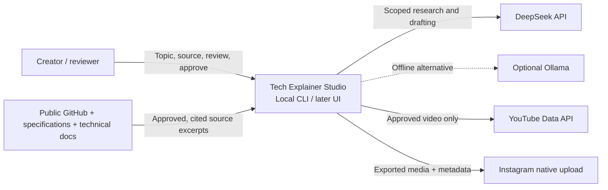
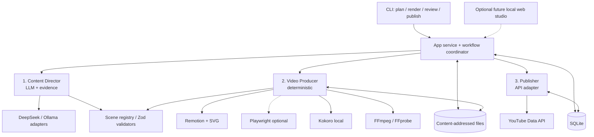
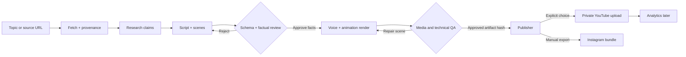
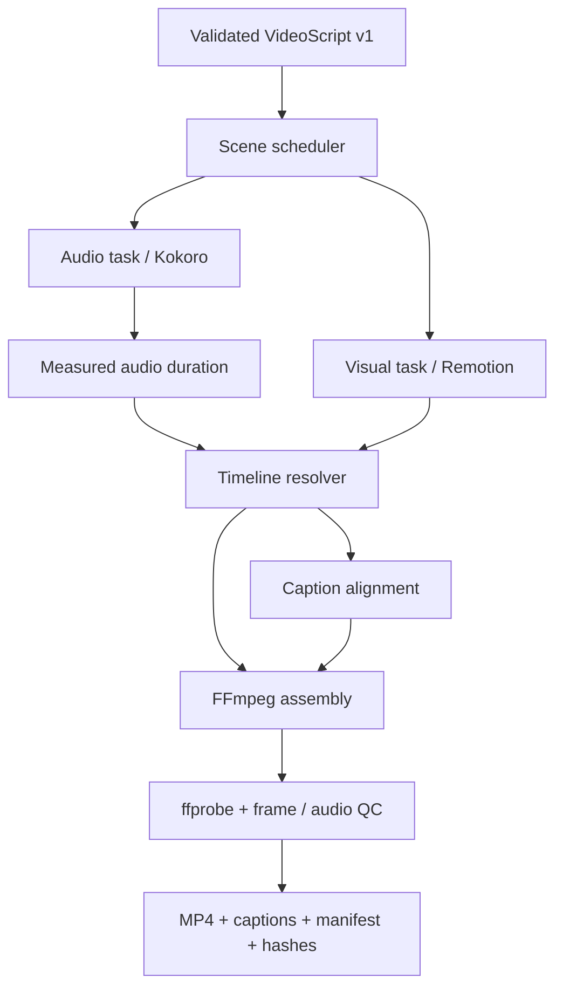
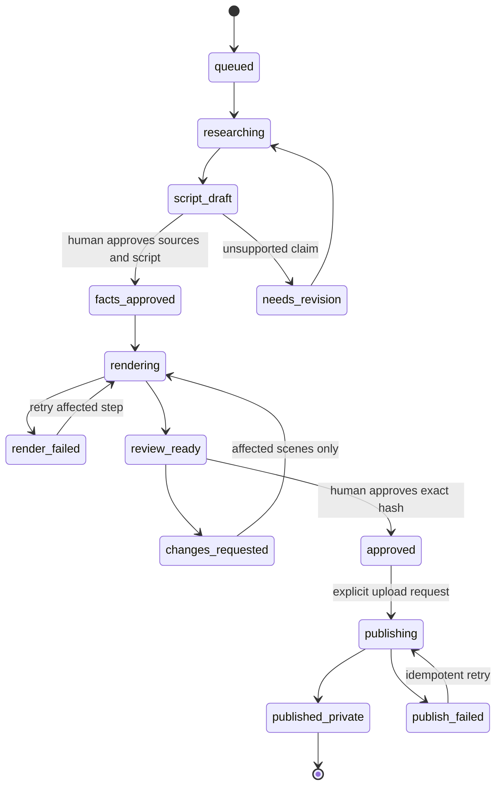

# 02 — Architecture and Mermaid diagrams

## 2.1 System context



**Trust boundary:** untrusted GitHub/web content is *reference data*, not instructions. Only user-confirmed sourced excerpts are sent to external AI providers; never send employer IP or secrets.

## 2.2 High-level containers



Three **roles**, not three autonomous always-on agents. The Director uses AI; Producer and Publisher are code services.

## 2.3 Pipeline and human gates



No transition from draft generation to a public video bypasses human quality approval. Gate checks are in application code, not merely prompt text.

## 2.4 Producer component flow



For **recorded UI scenes**, Playwright can run in a separate worker. Do not carry over the old constraint that a customer-facing video must show only live UI. Technical explainers should allow `tech-animation` in any scene position.

## 2.5 Persistent state machine



Public scheduling is **a separate explicit action** and not implied by a successful upload.

## 2.6 Proposed module organization

**Phase 01 foundation (retained):** one root TypeScript package, with `src/domain/` for Zod schemas and typed validation, `src/cli/` for local file validation/help, and `tests/` using Node's built-in test runner. `parseVideoScript(unknown)` and `parseVideoScriptJson(string)` return schema-inferred `VideoScriptV1` or throw `ScriptValidationError`. The domain component registry registers only the `BrowserRequestFlow` props schema and has no render function. Phase 01 introduced no API server, rendering, persistence or external integration; the Phase 02 extension below adds silent rendering.

**Phase 02 extension:** the same package now includes `src/visuals/` (original SVG flow/state/text components) and `src/renderers/remotion/` (silent planning, explicit renderer registry, composition, local browser/bundler orchestration, media tools/QC). The domain registry remains schema-only, keeping validation independent; a separate static render registry binds the approved ID to authored React code. `render --script` lazy-loads `render-cli.ts`; no LLM code or generated expressions are imported. Remotion's ephemeral asset server binds to loopback. Existing local Chrome is required, and font assets and FFmpeg/ffprobe are resolved from pinned dependencies. No browser/model download, API server, database or external integration is added. Render manifests describe **unapproved silent previews**, not release approvals. The directory tree below remains a future proposal.

**Phase 03 extension:** `src/audio/{provider,types,lexicon,process-runner,wav}.ts` plus the packaged `kokoro-worker.py` implement the `NarrationProvider` interface. `src/config/narration.ts` validates local config. The CLI lazy-loads `audio-cli.ts`; the worker receives JSON on stdin, trusted executable/asset paths from operator config, and literal normalized narration. It runs CPU-only ONNX inference with a recorded seed, CPU/file/thread/time/output limits and a minimal environment. It does not execute scene text, fetch assets or instantiate an LLM. The explicit mock is a test-tone provider. PCM/WAV validation and ffprobe measurement precede final per-scene artifact metadata. Original/spoken text hashes, asset/runtime identity and settings accompany each WAV. Output is exclusive and failures preserve earlier scenes. Timeline/captions/muxing and persistent recovery remain planned. No extra package or service is added.

**Phase 04 extension:** `src/timing/timeline.ts` is the browser-safe timeline/caption contract and planner; `src/media/{pcm,qc,pipeline,error}.ts` implement local artifact validation, padding/assembly and independent final-media QC; `src/render-manifest/manifest.ts` validates narration metadata and inventories exact implementation hashes. The existing Remotion composition accepts a strict presentation timeline and caption overlay while the silent path remains available. `narrated-cli.ts` loads saved artifacts/optional reviewed word alignment; no provider starts during this render-only command. Per-scene ffprobe/PCM checks precede rendering; final stream/frame probing plus AAC decoding precede finalizing `video.mp4`. Mock tones, scene-span fallback and overrides block strict media timing checks. All output stays explicitly unapproved; persistent jobs/cache, human release approvals and publishing are later phases.

```text
tech-explainer-studio/
├── apps/
│   ├── cli/                     # P0, command parsing / progress
│   └── studio/                  # P2, local review UI (not needed at launch)
├── packages/
│   ├── core/                    # contracts, validation, domain errors
│   ├── director/                # source adapters, prompts, LLM adapters
│   ├── producer/                # scene registry, remotion, audio, assembly
│   ├── publisher/               # YouTube + export bundle
│   └── persistence/             # SQLite and file store
├── docs/
├── examples/
└── output/                      # ignored, local-only
```

**Implementation caution:** This is an eventual directory target; begin as one TypeScript package if a monorepo makes the P0 vertical slice slower.

## 2.7 Deployment model

MVP runs as **a local CLI** on macOS (Apple Silicon). FFmpeg/FFprobe and a supported TTS runtime execute as subprocesses; Remotion renders via its supported Node/Chromium environment. SQLite and artifact store remain local. Deploying a cloud instance requires separate architecture and security review for OAuth tokens, remote browser automation, file storage and API abuse.

## 2.8 Key boundary interfaces

- `LLMProvider.generateObject<T>(messages, schema, budget) -> validated result + usage`
- `SourceProvider.fetch(url, limits) -> SourceSnapshot`
- `ContentDirector.plan(input, sources) -> VideoScriptDraft`
- `SceneRenderer.render(scene, resolvedTimeline) -> RenderArtifact`
- **Implemented:** `NarrationProvider.health() -> HealthReport`; `NarrationProvider.synthesize({sceneId, text, outputDir}) -> NarrationArtifact` (voice/lexicon/limits supplied by validated provider config)
- **Implemented:** `planNarratedRender(script, measuredAudio, {alignment?, allowFallback}) -> Timeline`; `renderNarratedPreview(script, options) -> manifest + QC report + timeline` (saved WAV inputs, no provider/LLM execution)
- `Publisher.publishApproved(releaseId, target) -> PublishResult`
- `ArtifactStore.put(bytes, metadata) -> sha256 address`

Every interface is **side-effect-explicit**, testable, and fails closed if invalid.
