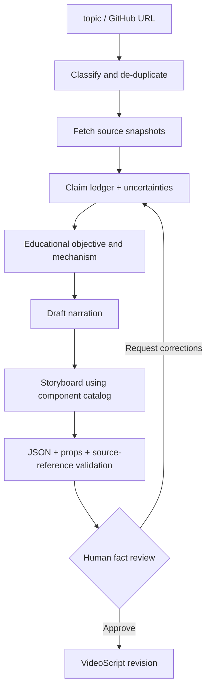

# 04 — Agent 1: Content Director

## Mission

Transform an approved technical topic or source URL into a **sourced, original, reviewable explanation** and schema-valid storyboard. Never attempt to create videos, upload files or execute untrusted source code as a side effect of planning.

## Separate decisions from facts

1. **Topic** (selected by creator or backlog): *What exactly will the viewer learn?*
2. **Source evidence**: *What do authoritative documents actually say?*
3. **Explanation model**: *What state transitions can be demonstrated visually?*
4. **Script**: *How to narrate one causal story with precision?*
5. **Storyboard**: *Which **registered** components express each transition?*
6. **Technical review**: *Are claims, ordering, exceptions and metaphors accurate?*

## Planned internal steps

## Source hierarchy

1. Official protocol specs, standards, API docs, original project README/implementation docs.
2. Primary conference talks, original papers, engineering blogs by maintainers.
3. Thorough reputable tutorials and reviewed guides.
4. Community discussion for topic discovery only, **not standalone evidence** of implementation details.

When sourced from [`build-your-own-x`](https://github.com/codecrafters-io/build-your-own-x), remember it is an **index** with links to third-party tutorials; inspect every linked work's own license and claims separately. Prefer to build an original demonstration rather than copy a code walkthrough.

## Implemented evidence foundation (Phase 05)

The Director flow remains planned. Its local evidence foundation now exists in `src/sources/`, `src/claims/ledger.ts` and `source`/`claims` CLI commands. Explicitly confirmed public URLs produce bounded minimized snapshots; no crawling, repo execution or provider calls occur. All text stays untrusted; suspicious documents lose their excerpt. Human JSON decisions must quote exact clean snapshot evidence, and a separate ledger approval is required to export inert reference context. Missing sources and unresolved statuses block approval. License mentions are unverified signals, never reuse rights. See [contracts](03-contracts.md), [security limits](11-security-and-legal.md) and the README workflow. Source freshness and live HTTP compatibility remain unverified here because the user selected mock fixtures only. This phase does not connect evidence to the existing VideoScript fixture or automate factual review.

The Phase 05 extension also implements `ResearchBundle` inputs for multiple public URLs/GitHub documents and pasted technical notes. Its separate validated brief stores topic/audience/emphasis/exclusions; every source has independent provenance and optional selected literal sections. Aggregate budgets, deduplication and the original per-source protections apply. `claims init --bundle` binds the bundle hash/brief into an unreviewed ledger; future Phase 06 can consume this versioned data without broad web research or exposing raw source instructions. Human semantic contradiction review remains necessary. See the README multi-source workflow and contract 1.1.0 extension.

## DeepSeek provider rules

- Use configured model ID from env (e.g. `deepseek-flash`); verify currently available IDs against official API docs.
- Send carefully selected **source excerpts with citations**, not entire arbitrary websites/README dumps.
- Use JSON output or JSON schema as supported by the selected endpoint, **then independently validate with Zod**. JSON syntax correctness is not semantic correctness.
- Use system/user instructions that explicitly demand JSON; handle empty/whitespace response, refusal, length truncation, rate limit and server errors.
- Set request timeout, retry exponential backoff with jitter, usage accounting, per-run max tokens and cost ceiling.
- Do not reveal chain-of-thought or rely on hidden reasoning traces; inspect observable claims and output artifacts.
- Provider switch to Ollama should not change downstream contract.
- If web access is unavailable, mark source freshness `unverified`; don't manufacture a source list.

## Director outputs

- `research.json`: sourced facts, claim/URL/revision pointers, unresolved disputes.
- `script.draft.json`: `VideoScript v1` with narration and visually representable mechanisms.
- `review.md`: uncertain claims, technical simplifications and required reviewer decisions.
- `prompt-manifest.json`: model, prompt version, request settings, token usage and invocation timestamp (never secrets).

## Content Director policy for technical accuracy

- Avoid converting *one plausible implementation* into an assertion about how a named company does it internally.
- Distinguish `HTTP/1.1` from `HTTP/2` and `HTTP/3` when explaining transport/protocol internals.
- Don't invent code snippets or APIs; any code demonstration must run under automated tests before publication.
- Each scene narration needs at least one source-supported `claim_id` for substantive technical statements; pure transitions may have none.
- Mark metaphors as metaphors. Example: queue diagrams can omit distributed failures, but cannot imply perfect ordering or exactly-once semantics without evidence.
- Never use a technical analogy that contradicts causality; an animated arrow must have a defined meaning.
- Technical reviewer must approve scripts with terms such as cryptography, memory safety, authorization, consistency or financial operations.

## Topic selection scoring (editorial, not verified search data)

`priority = (relevance*0.25 + visual_causality*0.25 + source_quality*0.20 + evergreen*0.15 + production_reuse*0.15) * 20` for criteria scored 1–5. Use demand metrics only when measured. Score is internal planning guidance and can be overridden by editor.

A topic is rejected or split when it requires more than **one** principal mechanism for a Short, lacks credible sources, needs unbounded asset generation, or cannot fit into an understandable voiceover without deceptive omissions.

## Prompt structure

Do not copy the old `phi-video-gen` prompt literally. It assumes end users of a specific internal product, disallows diagrams, and includes Figma selectors. Use versioned prompt fragments: `research`, `evidence`, `editorial`, `visual-planner`, `json-formatter` (see [17-prompts-and-evals.md](17-prompts-and-evals.md)). Enforce scene, licensing and output format restrictions **in code**.

## Tests

- Unknown component ID → reject.
- Unsupported source URL → report, no fabricated citation.
- Conflicting sources → conflict marked and escalated.
- JSON output valid but wrong schema → reject and one bounded repair attempt.
- Over budget → stop with resumable draft + clear cost audit.
- Prompt injection in source code/README → treated as inert content.
- Existing source script replay → no LLM call.
