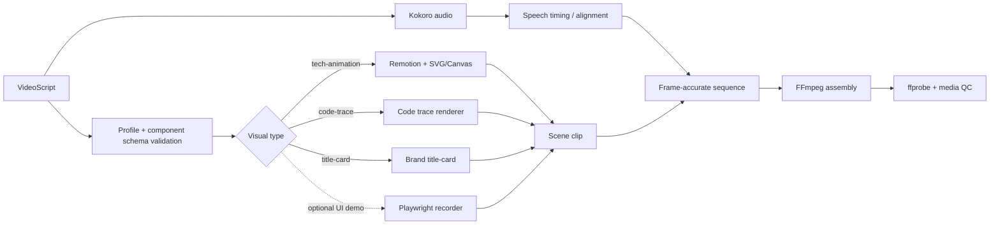

# 05 — Agent 2: Video Producer and animation engine

## Mission

Turn an approved `VideoScript` revision into synchronized narration, animated scenes, captions, metadata and a validated MP4. **No LLM calls are necessary** after a VideoScript is locked. The producer is a deterministic service within pinned render conditions, not a creative agent that improvises unknown visuals.

## Scene rendering architecture



## Visual component catalog: MVP

| Component | Inputs | Suitable topics | Safety/invariants |
|---|---|---|---|
| `BrowserRequestFlow` | browser, server, method, path, status, cue sequence | HTTP, API, proxies | Request before response; no misleading protocol labels |
| `NetworkPacket` | packet label, route, send/receive cues | TCP, DNS, queues | Clear transport/protocol distinction |
| `EventQueue` | bounded events, producer/consumer, delay, capacity | queues, Kafka concepts | Queuing policy/ordering explicitly labeled |
| `CodeTrace` | reviewed code lines, execution states, highlights | parsers, compilers, Git internals | Code runs in an isolated test harness |
| `BTreeLookup` | small tree fixture, lookup key, step path | DB indexing | Valid node structure and reproducible path |
| `HashObjectGraph` | nodes, parent edges, object type | Git | Hash labels marked illustrative unless computed |
| `TimelineCompare` | stages / durations / categories | latency, cache vs no cache | Numerical data labeled measured or illustrative |
| `DecisionTradeoff` | two designs, pros and limitations | architecture choices | Claims supported; no false universality |

Future: thread scheduler, CPU pipeline, cache hierarchy, distributed leader election, packets through NAT/load balancers, AST/compiler transforms, memory allocator, deterministic 3D hardware scenes.

## Camera and coordinates

- Composition defaults `1080 × 1920 @ 30fps` (9:16). Composition metadata is centralized, not hardcoded inside each component.
- Use a normalized virtual design area; separate **content-safe rectangle** from platform UI overlay exclusion regions.
- A scene may define `focusTarget`, `cameraPan`, `zoom` and transition cues, but only from an approved finite enum/typed value range.
- Prefer SVG/React for basic shapes and animation; Canvas for thousands of moving particles; Three.js only when 3D meaningfully improves comprehension.
- All animated positions must be seeded/deterministic (no `Math.random()` in render components without a fixed seed).
- Add `prefersReducedMotion` only to future interactive player; video itself should avoid excessive strobing/flash.

## Real narration-first timing

1. Normalize text (`HTTP` vs `H-T-T-P`, names), record a pronunciation lexicon.
2. Synthesize **each scene** to WAV using local Kokoro with explicit voice/rate settings.
3. Probe actual audio length (`ffprobe`) and detect silence/noise.
4. Align token/word spans using forced alignment or local transcription as a validation step; do not assume every word lasts equally long.
5. Derive an exact integer-frame timeline. Add holds only within approved scene duration constraints.
6. Bind visual cues to text anchors/normalized progress: e.g. `request leaves client` near narration `sends a request`.
7. Render scene; mux audio, scene clip and captions; mix effects/music only from approved licensed assets.
8. Re-probe final output for dimensions, duration, audio streams, codec and clipping.

### Example cue semantics

```json
{
  "cue_id": "request_in_flight",
  "trigger": { "kind": "phrase", "text": "sends an HTTP request" },
  "action": { "kind": "animate_packet", "from": "browser", "to": "server" },
  "minimum_hold_ms": 500
}
```

A missing/ambiguous anchor is an explicit validation error or requires reviewer repair; never silently fire all cues at frame zero.

## Output artifacts

```text
output/<job_id>/
├── source-snapshots/               # hashes, metadata, minimal excerpts
├── revisions/<n>/videoscript.json
├── scene-assets/<scene-id>/<hash>/
│   ├── narration.wav
│   ├── scene.mp4
│   └── timing.json
├── final/video-vertical.mp4
├── final/captions.srt
├── final/thumbnail.png
├── final/render-manifest.json
├── review/report.json
└── publication/                     # only after explicit approval
```

## Render cache and partial replay

- Scene render key includes normalized scene JSON, narration hash, theme version, code version, fps, resolution, fonts/assets, tool versions.
- Render file is written to temp path then atomically moved into cache after media QC.
- A scene edit dirties only that scene **unless** it changes global layout/theme, narrative timing dependencies or transitions.
- A narration edit dirties that scene's audio, alignment and video, plus any affected cross-scene timing/assembly.
- Publishing is never rerun as part of render retry.

## Error strategy

| Failure | Response |
|---|---|
| Missing component / unsupported props | Fail validation before expensive rendering |
| TTS pronunciation fails | Offer lexicon/voice edit; rerender audio only |
| Remotion render fails | Save logs/scene ID; retry same scene bounded times |
| Nonexistent visual source | Do not replace with deceptive image; request review |
| Captions out of range | Block release |
| Render too short / blank / silent | Block release; do not silently accept fallback |
| Invalid audio/video codecs | Retry assembly under alternate safe encoder preset |

## Rendering contract

```ts
interface SceneRenderer<TValidatedProps> {
  id: string;
  version: string;
  validate(props: unknown): TValidatedProps;
  render(input: {
    sceneId: string;
    props: TValidatedProps;
    durationFrames: number;
    fps: number;
    dimensions: { width: number; height: number };
    themeId: string;
    outputPath: string;
  }): Promise<{ outputPath: string; sha256: string; durationFrames: number }>;
}
```

Rendering code should not use network fetching, privileged commands or arbitrary expression execution inside props. Assets must be pre-approved and resolved before invoking the renderer.
