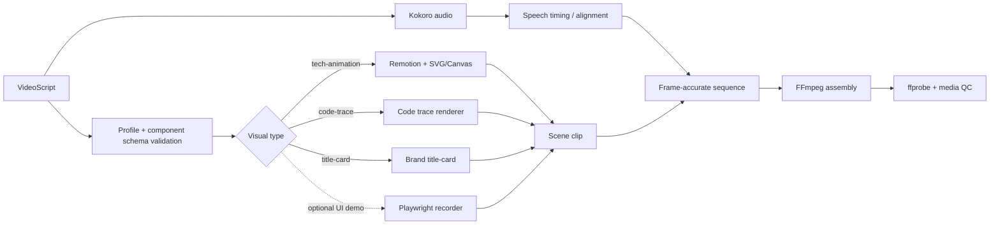

# 05 — Agent 2: Video Producer and animation engine

## Mission

Turn an approved `VideoScript` revision into synchronized narration, animated scenes, captions, metadata and a validated MP4. **No LLM calls are necessary** after a VideoScript is locked. The producer is a deterministic service within pinned render conditions, not a creative agent that improvises unknown visuals.

## Scene rendering architecture

**Phase 02 implemented slice:** `render --script` validates a local script, resolves saved preferred durations into integer frames, renders one portrait Remotion composition, saves PNG references, and probes the silent MP4. It supports only title cards and registered `BrowserRequestFlow`; this render path has no audio. Caption alignment, per-scene media cache and release approval remain planned. This is explicitly a **silent preview using estimates**, not an exception to measured-audio timing for narrated output. Other arrows/components below remain planned except the separate Phase 03 narration slice.



**Phase 03 implemented slice:** separate `audio` commands generate per-scene local Kokoro WAVs or explicitly labeled mock tones. Duration comes from ffprobe and is checked against PCM samples. Phase 04 now consumes these saved artifacts through a separate narrated render path; the original silent command is retained.

**Phase 04 implemented slice:** `render --narration` validates saved WAV/text identity and measures each scene again, resolves actual samples plus authored minimum holds, renders registered visuals/captions, muxes H.264/AAC and independently checks final video/audio. Reviewed word timings support phrase cues and grouped captions; an explicit full-scene speech-span fallback is preview-only and flagged for timing review. No automatic aligner, LLM, package/model download, caching or publisher runs. See document 03 for exact rounding/alignment contracts and the root README for executable commands.

## Visual component catalog: MVP

| Component | Inputs | Suitable topics | Safety/invariants |
|---|---|---|---|
| `BrowserRequestFlow` | browser, server, method, path, status, cue sequence | HTTP, API, proxies | Request before response; no misleading protocol labels |
| `NetworkPacket` | packet label, route, send/receive cues | TCP, DNS, queues | Clear transport/protocol distinction |
| `EventQueue` | bounded events, producer/consumer, delay, capacity | queues, Kafka concepts | Queuing policy/ordering explicitly labeled |
| `CodeTrace` | reviewed code lines, execution states, highlights | parsers, compilers, Git internals | Code runs in an isolated test harness |
| `BTreeLookup` | small tree fixture, lookup key, step path | DB indexing | Valid node structure and reproducible path |
| `HashObjectGraph` | nodes, parent edges, object type | Git | Hash labels marked illustrative unless computed |
| `TimelineCompare` | stages / durations / categories | latency, cache vs no cache | Numerical data labeled measured or illustrative |
| `DecisionTradeoff` | two designs, pros and limitations | architecture choices | Claims supported; no false universality |

Future: thread scheduler, CPU pipeline, cache hierarchy, distributed leader election, packets through NAT/load balancers, AST/compiler transforms, memory allocator, deterministic 3D hardware scenes.

## Camera and coordinates

- Composition defaults `1080 × 1920 @ 30fps` (9:16). Composition metadata is centralized, not hardcoded inside each component.
- Use a normalized virtual design area; separate **content-safe rectangle** from platform UI overlay exclusion regions.
- A scene may define `focusTarget`, `cameraPan`, `zoom` and transition cues, but only from an approved finite enum/typed value range.
- Prefer SVG/React for basic shapes and animation; Canvas for thousands of moving particles; Three.js only when 3D meaningfully improves comprehension.
- All animated positions must be seeded/deterministic (no `Math.random()` in render components without a fixed seed).
- Add `prefersReducedMotion` only to future interactive player; video itself should avoid excessive strobing/flash.

## Real narration-first timing

1. Normalize text (`HTTP` vs `H-T-T-P`, names), record a pronunciation lexicon.
2. Synthesize **each scene** to WAV using local Kokoro with explicit voice/rate settings.
3. Probe actual audio length (`ffprobe`) and detect silence/noise.
4. Align token/word spans using forced alignment or local transcription as a validation step; do not assume every word lasts equally long.
5. Derive an exact integer-frame timeline. Add holds only within approved scene duration constraints.
6. Bind visual cues to text anchors/normalized progress: e.g. `request leaves client` near narration `sends a request`.
7. Render scene; mux audio, scene clip and captions; mix effects/music only from approved licensed assets.
8. Re-probe final output for dimensions, duration, audio streams, codec and clipping.

### Example cue semantics

```json
{
  "cue_id": "request_in_flight",
  "trigger": { "kind": "phrase", "text": "sends an HTTP request" },
  "action": { "kind": "move", "target": "http-request" }
}
```

A missing/ambiguous anchor is an explicit validation error or requires reviewer repair; never silently fire all cues at frame zero.

This uses document 20's canonical data contract. Phase 04 resolves phrase triggers only from reviewed word timings bound to the exact audio/text. The silent renderer still accepts the fixture's progress windows and rejects phrase triggers. The old conceptual `animate_packet`/`minimum_hold_ms` fields are not part of VideoScript v1.

## Output artifacts

```text
output/<job_id>/
├── source-snapshots/               # hashes, metadata, minimal excerpts
├── revisions/<n>/videoscript.json
├── scene-assets/<scene-id>/<hash>/
│   ├── narration.wav
│   ├── scene.mp4
│   └── timing.json
├── final/video-vertical.mp4
├── final/captions.srt
├── final/thumbnail.png
├── final/render-manifest.json
├── review/report.json
└── publication/                     # only after explicit approval
```

Phase 03 currently uses `<output>/<scene-id>/<scene-id>.wav` with sibling `narration.json` and a top-level `narration-manifest.json`. A failed scene retains `narration-error.json` and any partial WAV for diagnosis. Successful scenes are preserved and existing directories are never overwritten. This is not yet a content-addressed cache or resume implementation.

## Render cache and partial replay

Phase 04 preview output currently contains `video.mp4`, `captions.srt`, `timeline.json`, `videoscript.json`, copied per-scene narration/metadata, padded `narration.wav`, `decoded-audio.wav`, captioned frame evidence plus a silent intermediate in `visuals/`, `ffprobe.json`, `qc-report.json` and `render-manifest.json`. The video is finalized only after stream/frame checks and per-scene decoded AAC checks. Error reports identify affected scenes; partial output is retained for diagnosis, and existing output directories are protected. The cache/resume rules below remain planned.

QC checks one 1080×1920, 30 fps H.264/yuv420p stream and one mono 24 kHz AAC stream, exact decoded video frames and audio/video/format duration within one frame plus one AAC packet (0.076 seconds). Every source/decoded scene must have AC audio activity above -45 dBFS and no near-full-scale samples. Structural WAV parsing permits final silence only long enough to identify the failing scene; it never passes QC. DC bias is reported for voice-quality review. Format/activity checks do not establish intelligibility, perfect captions or rights. Mock/fallback outputs and pending human checks never confer release approval.

- Scene render key includes normalized scene JSON, narration hash, theme version, code version, fps, resolution, fonts/assets, tool versions.
- Render file is written to temp path then atomically moved into cache after media QC.
- A scene edit dirties only that scene **unless** it changes global layout/theme, narrative timing dependencies or transitions.
- A narration edit dirties that scene's audio, alignment and video, plus any affected cross-scene timing/assembly.
- Publishing is never rerun as part of render retry.

## Error strategy

| Failure | Response |
|---|---|
| Missing component / unsupported props | Fail validation before expensive rendering |
| TTS pronunciation fails | Offer lexicon/voice edit; rerender audio only |
| Remotion render fails | Save logs/scene ID; retry same scene bounded times |
| Nonexistent visual source | Do not replace with deceptive image; request review |
| Captions out of range | Block release |
| Render too short / blank / silent when audio is required | Block release; the Phase 02 silent preview is explicitly marked unapproved and has no audio by design |
| Invalid audio/video codecs | Retry assembly under alternate safe encoder preset |

## Rendering contract

```ts
interface SceneRenderer<TValidatedProps> {
  id: string;
  version: string;
  validate(props: unknown): TValidatedProps;
  render(input: {
    sceneId: string;
    props: TValidatedProps;
    durationFrames: number;
    fps: number;
    dimensions: { width: number; height: number };
    themeId: string;
    outputPath: string;
  }): Promise<{ outputPath: string; sha256: string; durationFrames: number }>;
}
```

Rendering code should not use network fetching, privileged commands or arbitrary expression execution inside props. Assets must be pre-approved and resolved before invoking the renderer.

## Implemented silent renderer (Phase 02)

- The source fixture remains byte-identical. Its preferred durations resolve to 150, 300, 300, 270, 360 and 270 frames (55 seconds total). Scene boundaries are contiguous, rounded once per saved scene estimate. The manifest records `timingMode: silent-preview-estimates`, `measuredAudio: false`, and `approvedForRelease: false`.
- Static domain and render registries are separate. The latter binds `BrowserRequestFlow` to original React/SVG code; no component name becomes a dynamic import/evaluated expression. All six states are implemented; the unchanged movie uses request/parse/route/response, while separate validated gallery inputs exercise idle/overview.
- The renderer supports technology-explainer at 1080×1920, 30 fps. It rejects unsupported cues rather than guessing: only progress/move cues targeting the request in the request phase or response in the response phase are supported. Overview uses an authored request→processing→response schedule with no custom cues. Phrase triggers await actual narration alignment. Captions are unsupported in this slice.
- A pinned local Inter font is bundled from `@fontsource-variable/inter` 5.3.0 (OFL-1.1; license notice remains in that dependency). No browser is downloaded. Local Chrome/Chromium must exist; supply `--browser` outside the macOS default path. Remotion's pinned platform binaries provide FFmpeg/ffprobe, with their library directory supplied only to those subprocesses. No global installation/configuration is changed.
- Render output is an exclusive new directory. The composition checks text bounding rectangles for collisions and safe-region overflow; failures name the scene. Failed renders leave `render-error.json`, and incomplete scratch output is removed. Successful artifacts are moved from scratch only after ffprobe confirms one H.264/yuv420p stream, 1080×1920, 30 fps, exact decoded frame count/duration and no audio.
- Artifacts: `video.mp4`, six scene PNGs, two idle/overview PNGs, `gallery-inputs.json`, `ffprobe.json`, `render-manifest.json`. The manifest records script/video/still/font hashes, scene/frame mapping, theme, browser, Node, Remotion, encoder and platform. It grants no publishing rights. All generated artifacts remain ignored.
- Visual verification uses an explicitly reviewed local `golden-manifest.json` plus independent output, exact PNG hashes and per-decoded-frame YUV420p SHA-256. The bundled FFmpeg omits `framemd5`/rawvideo muxers; the verifier streams fixed-size rawvideo packets through its supported `image2pipe` muxer. It also reports MP4 byte identity. Neither pixel nor file hashes are promised across browser/font/encoder/OS changes; changing a baseline needs a new review. No future job recovery/cache or release manifest is implied.


## Phase 07 incremental producer wrapper

The existing complete Producer remains available through `render --script --narration`. SQLite jobs now reuse validated narration and captioned scene clips before calling the same timing/mux/independent QC path. Remotion accepts an optional inclusive global `frameRange` for scene-only clips; full composition context preserves chapter/progress pixels. Clip keys include measured timing/captions and global position/total frames, so timing changes may invalidate additional clips. Same measured pixels can reuse clips across waveform/voice changes; waveform hashes always invalidate dependent assembly.

Job exports use optional portable relative narration paths and include `job-manifest.json` with exact saved origin/research/review/brand/audio identities. Shared saved-audio validation retains the same checked bytes through copy, validates PCM/sample counts, rejects unsafe metadata and never follows metadata-supplied paths. Existing caption, audio, stream-count and ffprobe gates remain unchanged; no silent placeholders or approval are introduced. Job commands/cache/lease/recovery details are in [09 — data and CLI](09-data-and-api.md); actual verification is in PROJECT_STATUS.md.

## Phase 11 implemented expansion

The same Producer dispatches the seven current library components described in [20 — components](20-component-specs.md#phase-11-current-library-supersedes-the-p2-planning-sketches-above). CodeTrace is display-only: the earlier table's isolated harness is not implemented and supplied code never executes. Motion primitives now support bounded larger packets; cache causality remains reused. New mechanisms share the existing measured cue/caption pipeline and approved BrandProfile.

Reviewed local image layers are preflighted and copied into a dedicated publicDir for the actual Remotion bundle. Props contain ID/file/record hashes rather than paths/URLs; images are decoded before frame capture. Portable hashed bytes/records stay in render output, and manifests identify them. Phase 07 validates assets before reuse; hash/record changes affect visual keys, without requiring new narration. Phase 08 separately checks actual imported image inventory and credits and hashes the complete staged tree. No asset import review or rendering action grants release approval. Native WebP decoding is currently macOS-specific; PNG/JPEG and the strict passive SVG subset remain portable. See ADR-017 for limitations.

## Phase 11B spatial execution

`CityDemandHeatmap` is one statically registered SVG spatial template in the existing composition. Its four story quarters continuously establish traffic, disclose synthetic hotspots, push toward the focus region as authored vehicles approach, then return wide while demand changes. All geometry, pan/zoom, pulses, density interpolation and routes derive from frame/input. `renderMode:isometric-svg|flat-svg` is explicit and hash-bound; neither requires WebGL and no failed animation is silently replaced. Full stories accept 10–20s; individual beats 2–6s. Scene validation and measured presentation preflight enforce duration budgets. Maximums: 25 cells, four snapshots, 19 fixed buildings, six vehicles/five road waypoints, one pulse, zero textures/models/footage. Geometry is original; no real coordinates or tiles.

Existing asset preflight runs (empty imported asset set), BrandProfile/font readiness, measured Kokoro WAVs, caption band, audio mux/QC and hashed manifests remain authoritative. `spatialScenes` in the visual manifest records backend, mode, camera, budgets and explicit fallback availability. Scripts/cache keys retain exact data/routes/cues. Local tests rendered both modes with WebGL and external networking disabled; human visual/voice/word-timing review is pending. True GPU 3D stack integration and CI/hardware performance remain unverified. Actual metrics and failures are in PROJECT_STATUS.md.


## Phase 11C — Derived composition and shared continuity

The existing Remotion 4.0.542 composition dispatches ComposedScene alongside unchanged registered templates. No transitions package, GPU engine or dependency was installed. Strict 1.2.0 input passes the existing parser, measured narration/caption resolver, then `compileVisualPlan`; compiler output never chooses narration duration. Pure frame evaluation works in arbitrary frame order. Fixed row/column/grid layouts calculate pixel positions and cubic paths; labels use existing bounded fitting and actual browser collision checks.

At boundary B, outgoing content is frozen at its last local frame; incoming content advances for k=0..11, alpha=k/11. Only two content layers are present. Matched compatible IDs are omitted from both layers and drawn once at interpolated positions. Global caption band, chapter/progress and brand chrome remain singletons, while scene-local copy blends. The incoming-owned window does not subtract frames, overlap speech, reset captions or change measured mux duration. The remaining generic/specialized pair restrictions are exported in the same capability catalog and rejected as unsupportedCapability with exact scene/path context.

Measured speech activity supplies diagnostics, not word alignment. Every boundary is decomposed into original WAV tail, authored/rounding padding and next WAV head. ≥500ms and authored-intent mismatches trigger human decisions. Existing final AAC decode/QC remains independent; unexpected decoded activity mismatch fails media inspection. Long silence alone remains review-needed. Saved WAV bytes, authored revisions and full caption fallback warnings are retained. Captions based on whole-scene speech spans are still explicitly review-only.

Real caching, asset-backed file transfer, queue, specialized/mixed crossfade and matched handoff evidence is listed in PROJECT_STATUS.md and ignored `output/phase11c/REVIEW.md`. Encoded mobile frames and decoded boundary excerpts assist human complete-video playback; stills/tests do not grant visual or listening approval. Freeze metadata precedes the user-selected Kafka holdout. No per-topic runtime code, source fetching, dynamic SVG, installation or LLM is used by rendering.


### Engineering closure corrections

Only the heading layer fades through the midpoint of the existing 12-frame visual overlap; two different headings are never drawn together. Body layers retain u=k/11, and captions/chrome/progress remain singletons. Composed layout 1.0.1 reserves label/status/image geometry, validates clearances and uses 36px text without resizing nodes during status changes. Unsupported crowded combinations fail instead of clipping or downgrading.

Renderer capture is pinned to concurrency 1, disallowParallelEncoding:true and disableSharedMemoryCapture:true with the existing swangle browser backend. This reduces capture-order and memory variation without introducing another renderer or dependency. Results are evaluated under recorded browser/font/platform/encoder identities; the older failed pixel comparisons remain failed historical evidence. The short engineering-regression fixture verifies heading changes, matched identity, mixed/specialized boundaries and an asset-backed node with real measured narration. The old topic fixtures and frozen Kafka experiment are not redesigned for this correction.
