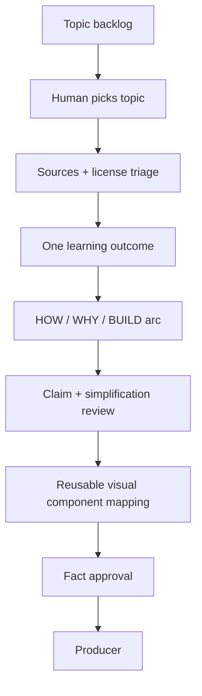

# 06 — Editorial system, source discovery, and rights

## Critical distinction

The user-provided DevMonk/Uber/quick-commerce references convey **animation language** (moving packets, grids, progressive reveal), **not** a topic mandate. The content plan is built around **computer science, GitHub build tutorials and system design**.

## Topic sources

- [Build Your Own X](https://github.com/codecrafters-io/build-your-own-x): discovery index for original projects and guides.
- [System Design Primer](https://github.com/donnemartin/system-design-primer): system-design concepts and diagrams to research independently.
- RFC Editor, IETF, MDN, official language/runtime/project documentation.
- Original GitHub implementations (reviewing actual source when permitted), code commits and maintainer docs.
- Hacker News and developer discussions: identify **questions**; verify facts elsewhere.

### Licensing principle

The Build Your Own X *index* is offered under CC0 according to its README, but many linked tutorials belong to **other authors with their own licenses**. A hyperlink is not blanket permission to reuse text, code examples, diagrams or video assets. Record separately: link, author, license, what is quoted, attribution need, and approval. Independent code and original animation are preferred.

## Editorial pipeline

### Story arcs

**HOW it works (35–70s):** familiar problem → show an input → introduce the mechanism → animate transformation → show output → acknowledge one trade-off or simplification.

**WHY design choice (30–60s):** naive approach fails → visual bottleneck → new structure → improvement → cost/trade-off.

**BUILD YOUR OWN X (40–75s Short):** observable goal → minimal architecture → smallest working implementation concept → edge case → explicit link to a **separate original repository or longer lesson**. Do not claim that a complete web server, compiler or database can be fully built in 60 seconds.

**WHAT is X (20–45s):** state a precise definition → demonstrate in a single animated interaction → connect to one real engineering use case.

## Recommended first six topics

| Priority | Topic | Learning objective | Reusable visual |
|---|---|---|---|
| 1 | How an HTTP server handles a request | Request/response lifecycle | `BrowserRequestFlow` |
| 2 | Why message queues exist | Buffer a burst; decouple producers/consumers | `EventQueue` |
| 3 | How Git stores a commit | Commit/tree/blob relationships | `HashObjectGraph` |
| 4 | How a database index searches | Traverse a B-tree-like index | `BTreeLookup` |
| 5 | How DNS resolves a name | Walk a resolver/authoritative path | `NetworkPacket` |
| 6 | Build your own URL shortener | Resolve short code to original URL; tradeoffs | `BrowserRequestFlow` + DB |

This is a **visual primitive test plan**, not a ranking based on measured market demand.

## Content sourcing data model

- Topic name, input URI, rationale, audience.
- Original author/organization and link; canonical repo commit or docs version if possible.
- Licensing decision (`link_only`, `reuse_with_notice`, `requires_permission`, `blocked`, `unknown`).
- Primary technical claims and exact cited pages/sections; evidence reliability.
- What the viewer should remember; what is omitted due to time.
- Visual primitives required, estimate of production work, reused component count.

## Duplicate prevention

Normalize topic to `{system, core_mechanism, audience, depth}` (e.g. `{HTTP, request_response, beginner, intro}`). Search backlog for overlap. Similar subjects may become a series only if each has a different measurable educational objective.

## Claims verification rules

- Distinguish illustrative data and actual measured values.
- Illustrative latency, scale, error rates or throughput must have `simulation` labels.
- For brand-named architecture, use framing such as `A possible design` unless the source explicitly documents that brand's implementation.
- If a tutorial's code no longer runs, either fix and verify an **original** implementation or avoid showcasing it as functional.

## Cross-posting approach

One master vertical output, platform-safe UI zones, captions and separate metadata. Adjust titles/description/hashtags to channel context. Native upload and review first; automation only after adherence to official platform policies is confirmed.
