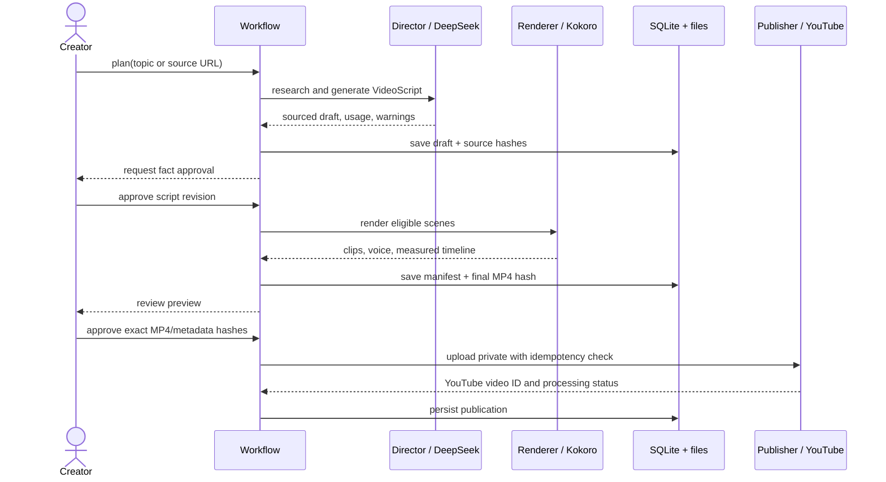
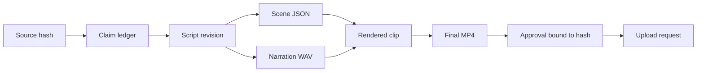

# 07 — Workflow orchestration, approvals, retries, and cost control

## Design choice

Use a small TypeScript job runner backed by SQLite for P0. Do **not** introduce LangGraph, CrewAI, n8n or Temporal until multi-user concurrency, external schedules, distributed workers, or failure rates justify the operational burden. The architecture remains compatible with later adapters.

## Job steps

**Phase 04 implemented scope:** an exclusive-directory local render-only pipeline consumes saved narration, renders captioned visuals, muxes and writes a QC/review manifest. Phase 07 now wraps it with the local SQLite runner described below. Phase 08 adds the separate local release gates below; network publishing remains planned. Failed output retains scene/stage diagnostics and successful caches. All preview manifests remain explicitly unapproved, including those passing strict media checks.

`queued → sources_fetched → research_done → script_draft → facts_approved → narration_ready → scenes_rendered → assembled → review_ready → approved → upload_requested → uploaded_private`

Each step has `input_hash`, `output_hash`, `status`, attempt count, timestamps, error code, and `worker_version`. Failures persist state and can resume from the last valid artifact.

## Sequence diagram



## Idempotency and concurrency

- Run key: `job_id` (UUID); step key: `{job_id, step_name, input_hash}`.
- Only one lock/lease holder can mutate a job at a time. Stale leases are recoverable after heartbeat timeout.
- Upload outbox stores requested target and artifact hash **before** network operation. On uncertain response, check existing publication records and remote status where possible; do not blindly retry upload.
- A re-render never implicitly calls publisher. `publish` is its own explicit CLI operation.
- Limit Remotion and TTS concurrency to machine capacity; default **one video pipeline at a time**.

## Retry classification

| Error class | Retry? | Policy |
|---|---|---|
| API timeout, rate limit, temporary server errors | Yes | 2–3 attempts, exponential backoff and jitter |
| Invalid model JSON or wrong component props | Conditional | One bounded correction round, then human review |
| Missing citations, unlicensed assets, incorrect protocol | No auto-accept | Human editorial decision |
| Remotion process crash | Yes | Retry scene once with diagnostics; then fail visibly |
| YouTube OAuth revoked | No | Reauthorize interactively |
| Duplicate upload uncertain | No blind retry | Reconcile with stored request and remote account |

## Caching and invalidation graph



On source change, **do not silently regenerate approved content**. Mark the topic `source_changed` for manual editorial review. On theme change, invalidate all dependent visual clips. On scene text change, invalidate that scene's audio and clip and recompute downstream timestamps.

## Human approvals

`facts_approved`: reviewer confirms claim grounding and simplifications.  
`media_approved`: reviewer confirms media asset provenance/license.  
`video_approved`: reviewer inspects playback, captions, visuals and audio.  
`publish_approved`: reviewer confirms platform, privacy, title and final rendered checksum.

All required gates must be true for the same immutable release manifest. An approval is **not** permanent across changes.

## LLM budget guardrails

- Per-episode max request count, input/output token ceilings, and USD budget computed from configurable provider pricing.
- Never fail over automatically from free/local to paid API without explicit user opt-in.
- Save provider usage estimates; if provider lacks usage reporting, label estimate.
- Provide `--max-api-usd`, `--offline`, `--dry-run`, `--skip-director`, `--render-only`, and `--no-publish` options.
- Research source fetching has bounded page/file size and per-domain rate limits.

## Observability

Log `{jobId, stage, sceneId, attempt, durationMs, model, tokensIn, tokensOut, costEstimate, assetHash, errorCode}`; redact prompts/URLs containing secrets. Write human-readable `run-summary.md`. At MVP, local structured logs and a readable job state command suffice; metrics dashboards are later.


## Phase 07 implemented runner

The long editorial/publication sequence above remains a target, not a claim of complete workflow automation. Actual job states are `queued → running → review_ready` with `failed`, `paused` and `needs_review` branches. Steps are `audio`, `scene` and `assembly`; each completed step binds its input hash to a verified file group/output hash in one transaction. Unknown/invalid transitions fail. CLI errors expose code, stage and scene; private attempt folders retain detailed existing Producer/renderer diagnostics. Retry is explicit through resume, limited to two attempts per unchanged failed/interrupted input. No whole-video fallback, LLM generation or publishing runs after a scene failure.

One 120-second job lease and one local producer lease renew every 15 seconds. Replacement owners fence expired workers; unfinished steps become `abandoned` and consume an attempt. Import/revise uses immutable snapshots; a unique request key makes creation idempotent, and optional `--expected-version` rejects stale edits. Paused state survives revisions/resume, and source/claim/bundle/ledger changes retain a review gate even through pause/continue. Clear that gate only by importing a current, reviewed Director draft with matching approved bundle/ledger. Initial legacy unbound imports are still explicitly unapproved previews.

Imported provider usage is an idempotent receipt from a saved Director draft: model, request hash, token estimates, conservative reserves, outcome and configured pricing. No raw generation brief/system prompt/API key is stored in usage records. These are local estimates from imported receipts, not billing verification or a new provider call. Re-importing a receipt does not charge/count it again. Separate real requests with identical exported receipts cannot be distinguished without a future provider request ID.

The scene renderer uses Remotion's inclusive measured `frameRange` while retaining the full composition context. Good clips/WAVs survive retries. Clip cache keys intentionally include chapter ordinal, global start and total duration because those change visible header/progress pixels. Same-duration waveform/voice changes can reuse clips; timing changes can affect additional clips. Colors/fonts/caption style affect visuals, not unchanged speech. A visual edit with unchanged timing rebuilds that scene and assembly only. No arbitrary brand override, alternative resolution, approval command or publisher is added in this phase.

## Phase 08 implemented release reviews

SQLite schema 2 adds immutable `releases` and append-only `release_reviews` / `release_audit`; schema-1 jobs migrate in place. The Phase 07 `renders.approved_for_release=0` constraint remains unchanged. A candidate is a separately hashed `ReleaseManifest` with exact local file inventory, author/origin, optional job revision/snapshot binding and four dependency digests. `release inspect` exports its immutable JSON. Files remain at their original canonical locations: modifying or deleting an input makes that candidate stale; `prepare` creates a new candidate rather than rewriting one.

Use the actual render output directory (containing `video.mp4`, `videoscript.json`, narration, SRT, timeline and preview manifest). No research, model, upload or paid provider call is made:

```bash
npm run studio -- release inventory --render output/my-render --bundle output/research/research-bundle.json --cover output/my-cover.png --output output/rights.json
# Manually complete rights.json as described below, then:
npm run studio -- release prepare --render output/my-render --bundle output/research/research-bundle.json --ledger output/claims-ledger.json --rights output/rights.json --metadata output/metadata.json --cover output/my-cover.png --author script-author --origin manual_import
npm run studio -- release package --release <release-id> --output output/reviewer-package.md
npm run studio -- review facts --release <release-id> --reviewer independent-editor --rationale "Checked every claim and simplification" --decision approve
npm run studio -- review rights --release <release-id> --reviewer rights-editor --rationale "Checked rights evidence and credits" --decision approve
npm run studio -- review video --release <release-id> --reviewer playback-editor --rationale "Watched and listened to the exact MP4" --decision approve --playback --pronunciation --subtitles --pacing --timing-warnings
# Separate explicit action, only after the first three gates:
npm run studio -- review publish --release <release-id> --reviewer release-editor --rationale "Confirmed final metadata and private destination" --decision approve --metadata-reviewed
npm run studio -- release check --release <release-id>
npm run studio -- release audit --release <release-id>
```

Repeat `--data <directory>` on every command if not using default `data/studio.sqlite`. Optional `prepare --job <id>` binds the active review-ready Phase 07 revision, matching render, origin and evidence gate. Imported/hosted-model scripts use the same gates; declare `--origin deepseek` for that saved provenance, without calling DeepSeek. Reviewer identities are lowercase local operator assertions, not login accounts. The fact reviewer, each claim reviewer and the existing ledger approver must differ from the declared script author. Phase 05's reviewed, approved, exact bundle/claim ledger is still required; Phase 06 draft review cannot substitute for a release gate. `--decision reject` records a new decision instead of erasing history.

`metadata.json` is strict: `{ "title": "Example", "description": "Original explanation with required credits", "tags": [], "destination": "youtube", "privacy": "private", "madeForKids": false, "containsSyntheticMedia": true }`. Audience and disclosure values are proposed creator decisions that must be confirmed in the separate metadata review. Public privacy and unknown metadata fields are rejected. A future network adapter still requires its separately authorized explicit invocation; this phase implements no upload command.

The inventory starts every asset at unknown/unreviewed, including original visuals and AI images. In JSON, set its rights (`permitted`, `original`, or `reference-only` for cited sources), license evidence, attribution requirement/text, and `review: { reviewer, reviewedAt, rationale, assetSha256 }` after human examination. `assetSha256` must equal the asset's exact hash. Known license mentions in a source are not a reuse grant. Required credits must appear verbatim in the final description. The generated inventory covers each source ID, authored visual configuration, actual font, voice/model hashes and cover; add every optional imported visual asset. Imported media needs a regular local file path; source/model/code-native references can use null. Asset schemas cover images, layered illustrations, stock, Lottie/Rive, fonts, textures, 3D, tiles and AI images as future integration points; no fetching, decoding, crawling or visual pipeline for those formats is introduced.

Dependency behavior:

| Edit | Reviews requiring a new decision |
|---|---|
| Claims, sources, bundle, ledger decisions, narration wording or author | Facts and publish; playback also if rendered files change |
| Asset bytes, visual configuration, cover, model/voice-library licensing identity, rights evidence | Rights, publish; playback when visual/audio files or asset references change |
| WAV, voice/rate, BrandProfile, scene/caption/timing/MP4 or render provenance | Playback and publish; rights if its inventory changes |
| Title/tags/disclosure or unrelated description text | Publish |
| Remove a required attribution | Rights and publish |

Matching fact/rights/video dependency reviews are retained across candidates of the same script/job subject, including their rejection history; publish review is candidate-specific and also binds the current three gate decision IDs. A new review decision invalidates a previous publish pass until explicitly reviewed again. Every eligibility check freshly hashes the complete render tree and referenced inputs, revalidates evidence/rights, reprobes the MP4 and independently decodes AAC per scene. Mock tones, silent/missing/clipped audio, wrong format, inconsistent narration identities and stale SRT/timelines fail. Scene-span captions remain flagged; explicit playback acknowledgement records review without falsely relabeling them word-aligned. There is no saved/cached eligibility boolean that can bypass these checks.

A registered `previewOnly` component (currently the focused `CacheAsideProof` prototype) also blocks release playback approval. A video-review checkbox cannot promote that component into the approved library or substitute for its separately requested visual approval. The real motion-proof package therefore remains useful for review while intentionally ineligible for publishing.
