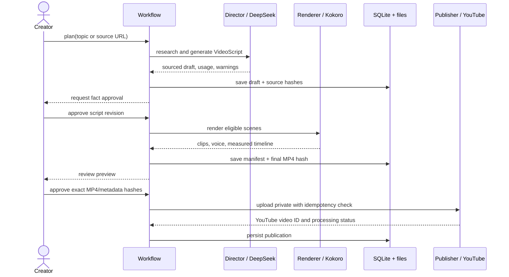
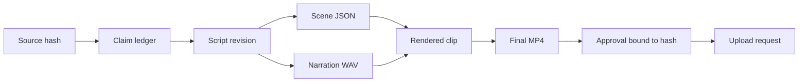

# 07 — Workflow orchestration, approvals, retries, and cost control

## Design choice

Use a small TypeScript job runner backed by SQLite for P0. Do **not** introduce LangGraph, CrewAI, n8n or Temporal until multi-user concurrency, external schedules, distributed workers, or failure rates justify the operational burden. The architecture remains compatible with later adapters.

## Job steps

**Phase 04 implemented scope:** an exclusive-directory local render-only pipeline consumes saved narration, renders captioned visuals, muxes and writes a QC/review manifest. Phase 07 now wraps it with the local SQLite runner described below. Approval (Phase 08) and publishing remain planned. Failed output retains scene/stage diagnostics and successful caches. All preview manifests remain explicitly unapproved, including those passing strict media checks.

`queued → sources_fetched → research_done → script_draft → facts_approved → narration_ready → scenes_rendered → assembled → review_ready → approved → upload_requested → uploaded_private`

Each step has `input_hash`, `output_hash`, `status`, attempt count, timestamps, error code, and `worker_version`. Failures persist state and can resume from the last valid artifact.

## Sequence diagram

## Idempotency and concurrency

- Run key: `job_id` (UUID); step key: `{job_id, step_name, input_hash}`.
- Only one lock/lease holder can mutate a job at a time. Stale leases are recoverable after heartbeat timeout.
- Upload outbox stores requested target and artifact hash **before** network operation. On uncertain response, check existing publication records and remote status where possible; do not blindly retry upload.
- A re-render never implicitly calls publisher. `publish` is its own explicit CLI operation.
- Limit Remotion and TTS concurrency to machine capacity; default **one video pipeline at a time**.

## Retry classification

| Error class | Retry? | Policy |
|---|---|---|
| API timeout, rate limit, temporary server errors | Yes | 2–3 attempts, exponential backoff and jitter |
| Invalid model JSON or wrong component props | Conditional | One bounded correction round, then human review |
| Missing citations, unlicensed assets, incorrect protocol | No auto-accept | Human editorial decision |
| Remotion process crash | Yes | Retry scene once with diagnostics; then fail visibly |
| YouTube OAuth revoked | No | Reauthorize interactively |
| Duplicate upload uncertain | No blind retry | Reconcile with stored request and remote account |

## Caching and invalidation graph

On source change, **do not silently regenerate approved content**. Mark the topic `source_changed` for manual editorial review. On theme change, invalidate all dependent visual clips. On scene text change, invalidate that scene's audio and clip and recompute downstream timestamps.

## Human approvals

`facts_approved`: reviewer confirms claim grounding and simplifications.  
`media_approved`: reviewer confirms media asset provenance/license.  
`video_approved`: reviewer inspects playback, captions, visuals and audio.  
`publish_approved`: reviewer confirms platform, privacy, title and final rendered checksum.

All required gates must be true for the same immutable release manifest. An approval is **not** permanent across changes.

## LLM budget guardrails

- Per-episode max request count, input/output token ceilings, and USD budget computed from configurable provider pricing.
- Never fail over automatically from free/local to paid API without explicit user opt-in.
- Save provider usage estimates; if provider lacks usage reporting, label estimate.
- Provide `--max-api-usd`, `--offline`, `--dry-run`, `--skip-director`, `--render-only`, and `--no-publish` options.
- Research source fetching has bounded page/file size and per-domain rate limits.

## Observability

Log `{jobId, stage, sceneId, attempt, durationMs, model, tokensIn, tokensOut, costEstimate, assetHash, errorCode}`; redact prompts/URLs containing secrets. Write human-readable `run-summary.md`. At MVP, local structured logs and a readable job state command suffice; metrics dashboards are later.

## Phase 07 implemented runner

The long editorial/publication sequence above remains a target, not a claim of complete workflow automation. Actual job states are `queued → running → review_ready` with `failed`, `paused` and `needs_review` branches. Steps are `audio`, `scene` and `assembly`; each completed step binds its input hash to a verified file group/output hash in one transaction. Unknown/invalid transitions fail. CLI errors expose code, stage and scene; private attempt folders retain detailed existing Producer/renderer diagnostics. Retry is explicit through resume, limited to two attempts per unchanged failed/interrupted input. No whole-video fallback, LLM generation or publishing runs after a scene failure.

One 120-second job lease and one local producer lease renew every 15 seconds. Replacement owners fence expired workers; unfinished steps become `abandoned` and consume an attempt. Import/revise uses immutable snapshots; a unique request key makes creation idempotent, and optional `--expected-version` rejects stale edits. Paused state survives revisions/resume, and source/claim/bundle/ledger changes retain a review gate even through pause/continue. Clear that gate only by importing a current, reviewed Director draft with matching approved bundle/ledger. Initial legacy unbound imports are still explicitly unapproved previews.

Imported provider usage is an idempotent receipt from a saved Director draft: model, request hash, token estimates, conservative reserves, outcome and configured pricing. No raw generation brief/system prompt/API key is stored in usage records. These are local estimates from imported receipts, not billing verification or a new provider call. Re-importing a receipt does not charge/count it again. Separate real requests with identical exported receipts cannot be distinguished without a future provider request ID.

The scene renderer uses Remotion's inclusive measured `frameRange` while retaining the full composition context. Good clips/WAVs survive retries. Clip cache keys intentionally include chapter ordinal, global start and total duration because those change visible header/progress pixels. Same-duration waveform/voice changes can reuse clips; timing changes can affect additional clips. Colors/fonts/caption style affect visuals, not unchanged speech. A visual edit with unchanged timing rebuilds that scene and assembly only. No arbitrary brand override, alternative resolution, approval command or publisher is added in this phase.
