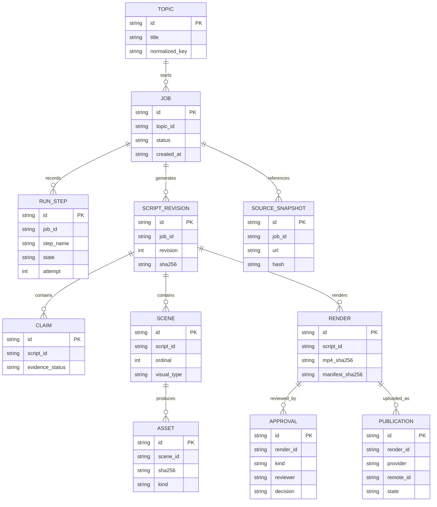

# 09 — Local data design, storage, CLI, and future HTTP API

## Architecture choice

- **SQLite** for job state, metadata, reviews, source index, and upload record.
- **Files on disk** for large binary audio/video/frames. SQLite stores only paths and hashes, not entire MP4s.
- **JSON** for versioned scripts and manifests that can be inspected without a database.
- Database must be replaceable behind repository interfaces if cloud deployment becomes necessary.

## Relational schema (logical)



## Suggested tables and constraints

- `topics(id, title, normalized_key UNIQUE, created_at)`
- `jobs(id, topic_id, profile, status, active_script_revision, created_at, updated_at)`
- `steps(id, job_id, name, input_hash, output_hash, status, attempts, error_code, started_at, finished_at, UNIQUE(job_id,name,input_hash))`
- `sources(id, job_id, url, canonical_url, revision, retrieved_at, content_hash, license_status, trust_level)`
- `script_revisions(id, job_id, revision, json_path, script_hash, prompt_version, model_id, created_at, UNIQUE(job_id,revision))`
- `assets(id, job_id, scene_id, kind, sha256 UNIQUE, path, byte_size, provenance_json, created_at)`
- `renders(id, job_id, script_revision_id, video_hash, manifest_path, video_path, status, created_at)`
- `approvals(id, render_id, kind, approved_hash, reviewer, decision, comment, created_at)`
- `publications(id, render_id, destination, idempotency_key UNIQUE, remote_id, intended_state, observed_state, created_at, updated_at)`
- `ai_usage(id, job_id, step_id, provider, model, prompt_tokens, completion_tokens, estimated_cost_usd, created_at)`

Add foreign keys, migrations, indexes for `(job_id,status)`, and transaction boundaries. Avoid plaintext OAuth refresh tokens inside SQLite.

## Directory layout and durability

- `data/studio.sqlite` + backup snapshots.
- `data/cache/sha256/...` immutable render inputs/outputs.
- `output/<job-id>/...` user-facing exported tree.
- `config/local.json` non-secret preferences.
- `.env` developer secrets (gitignored), OS Keychain for OAuth tokens when practical.
- Persist a **sidecar JSON manifest** for every final video, with all dependency hashes.

Atomic writes: write `.tmp`, flush where appropriate, rename. SQLite in WAL mode can help local concurrent readers; still use application-level job leasing.

## CLI spec (implemented commands and future targets)

Phase 01 implements `studio script validate --file <path>` and help only. Run locally with `npm run studio -- script validate --file examples/http-server.videoscript.json`, or after `npm run build` use `node dist/cli/index.js script validate --file <path>`. Success emits `{ "valid": true, "script_id": "...", "schema_version": "1.0.0", "scene_count": 6 }` on stdout. Validation errors emit `{ "error": { "code": "...", "message": "...", "issues": [{ "code": "...", "scene_id": "...", "path": "...", "reason": "..." }] } }` on stderr. Help exits `0`; usage, unreadable files, malformed JSON and schema failures exit `2`; unsupported visual/component failures exit `3`. There are no external calls or credential requirements. These commands do not create a database or output media.

Phase 02 additionally implements `studio render --script <path> [--output <new-directory>] [--browser <executable>] [--guides]`. It lazy-loads the silent renderer, checks media output, emits result JSON with output path/frame count/video hash on stdout and progress on stderr. Schema-valid unsupported rendering features exit `3`; browser/output/render/QC failures exit `5` with stage/scene/reason. Output must be a new directory; there is no overwrite or publishing side effect. Local Chrome and npm-installed fonts/platform binaries are prerequisites, not fetched at render time. Saved preferred durations are preview estimates, not narrated timings.

The list below is the broader target CLI. Implemented Director/evidence/audio commands are documented in their phase sections; Phase 07 job commands are listed explicitly below. `review`, `publish`, `init`, `topic`, and the HTTP API remain proposals:

```bash
studio init
studio doctor
studio topic add --url https://github.com/codecrafters-io/build-your-own-x
studio plan --topic "How an HTTP server processes a request" --provider deepseek --max-api-usd 0.50
studio plan --source https://developer.mozilla.org/en-US/docs/Web/HTTP/Overview --offline
studio script validate --file output/episode/videoscript.json
studio review facts --job <job-id>
studio render --script output/episode/videoscript.json
studio render --job <job-id> --scene <scene-id>
studio review video --job <job-id>
studio publish youtube --job <job-id> --privacy private
studio export instagram --job <job-id>
studio jobs list
studio jobs inspect <job-id>
studio jobs resume <job-id>
```

CLI must not require LLM access for `doctor`, `script validate`, `render --script`, or `jobs inspect`.

### Exit codes

| Exit | Meaning |
|---|---|
| `0` | Completed |
| `2` | Invalid input/schema |
| `3` | Unsupported media/component |
| `4` | External provider or network failure |
| `5` | Render/QC failure |
| `6` | Approval/rights gate failure |
| `7` | Publication blocked or reconciliation needed |

## Future local API (P2, not a reason to build Express now)

```text
POST /api/v1/topics
POST /api/v1/jobs
GET  /api/v1/jobs/:id
POST /api/v1/jobs/:id/plan
POST /api/v1/jobs/:id/render
POST /api/v1/jobs/:id/approve-facts
POST /api/v1/jobs/:id/approve-video
POST /api/v1/jobs/:id/publish-youtube
GET  /api/v1/jobs/:id/assets
GET  /api/v1/jobs/:id/events
```

All mutating endpoints require local authentication/CSRF protections if accessed via browser, and HTTPS + strong authentication if ever exposed outside localhost. Server rejects raw shell or arbitrary source-to-code execution requests. `POST` returns a job/action ID, never blocks on a long render. Publish requires exact hash precondition and idempotency key.

### Error contract

```json
{
  "error": {
    "code": "UNKNOWN_VISUAL_COMPONENT",
    "message": "The scene references a component not in the approved registry.",
    "job_id": "job-example",
    "scene_id": "scene-03",
    "retryable": false
  }
}
```


## Phase 07 actual SQLite schema and commands

Node 24 native `node:sqlite` requires no additional dependency/service. Migration 1 creates `jobs`, immutable `script_revisions`, `steps`, `leases`, `assets`, `cache_entries`, `renders` and `ai_usage`. Foreign keys, unique request/step/revision keys, WAL, FULL synchronization and write transactions are enabled. Future schema versions are rejected. Phases 01–06 had no database to upgrade: import their validated JSON with the existing default-brand resolution instead. The logical topic/source/approval/publication tables above are still future targets; source/claim references currently live inside bounded validated revision JSON.

```bash
# Create once from existing local inputs (or replace --narration with --config).
npm run studio -- jobs create --script examples/http-server.videoscript.json --narration output/my-audio --allow-caption-fallback --key my-http-job
npm run studio -- jobs list
npm run studio -- jobs inspect <job-id>
npm run studio -- jobs resume <job-id>
# Only if missing speech should be generated with the saved offline provider:
npm run studio -- jobs resume <job-id> --allow-local-synthesis
npm run studio -- render --job <job-id> --scene scene-02-request
npm run studio -- jobs pause <job-id>
npm run studio -- jobs continue <job-id>
npm run studio -- jobs revise <job-id> --script edited.json --expected-version <version>
# Bound drafts require saved approved evidence; a current draft review clears an evidence-change pause:
npm run studio -- jobs revise <job-id> --draft reviewed-draft.json --bundle bundle.json --ledger ledger.json
```

Repeat custom path options on subsequent commands. Common options: `--data` defaults to `data`; `--output-root` defaults to `output/jobs`; `--browser` selects an existing executable. `jobs create/revise` accept one `--script` or `--draft`, optional `--config`, saved `--narration`, `--alignment`, `--allow-caption-fallback`, `--strict`. Existing saved narration remains authoritative until explicitly replaced. A narrator/config change clears incompatible saved audio references; synthesis needs explicit opt-in. `--strict` still rejects mock speech and unreviewed caption fallback. Human word alignment is bound to WAV/text hashes and must be updated after affected audio changes.

Artifacts: `<data>/studio.sqlite`, `<data>/cache/sha256/<prefix>/<hash>`, retained failures under `<data>/work/<job-id>/attempt-*`, and `<output-root>/<job-id>/revision-N/<assembly-hash>/`. Full exports include MP4, SRT, all WAV/metadata, timeline, clip PNGs/manifests, ffprobe/QC, Producer manifest and `job-manifest.json`. Known artifact paths in job-rendered metadata are relative to the export root, so cached exports can move. A scene-only export is a silent captioned clip, not a completed narrated video. Its output lives under `revision-N/scenes/` and it needs all measured scene WAVs for timeline context.

Cache mappings are committed only after immutable blob writes and a current fencing check. Every hit verifies all file sizes/hashes. Exports use independent copies and a staged directory rename; existing changed exports fail visibly rather than being overwritten. Crashes between file and database publication are recovered by verifying/adopting the same saved artifact group. No render approval survives a revision; the table has a constraint forbidding release approval in this phase. Review-ready means a preview is available, not that facts/rights/video are approved.

New command exit codes: 2 input/schema/options; 5 storage/lease/transition/retry/render/QC failures; 6 paused/evidence-review resume. Existing commands keep their own established codes. Resume never constructs an LLM provider, re-fetches research, reads API keys, or requests payment authorization.

Unchanged failed/interrupted inputs have a two-attempt per-job budget. Repair the inputs/dependencies first; a deliberately new `--key` can create a fresh job budget after an environment repair when the input identity itself is unchanged. Verified caches are shared, so this does not require repeating good scene work. No automatic unlimited retry or hidden budget reset occurs.
