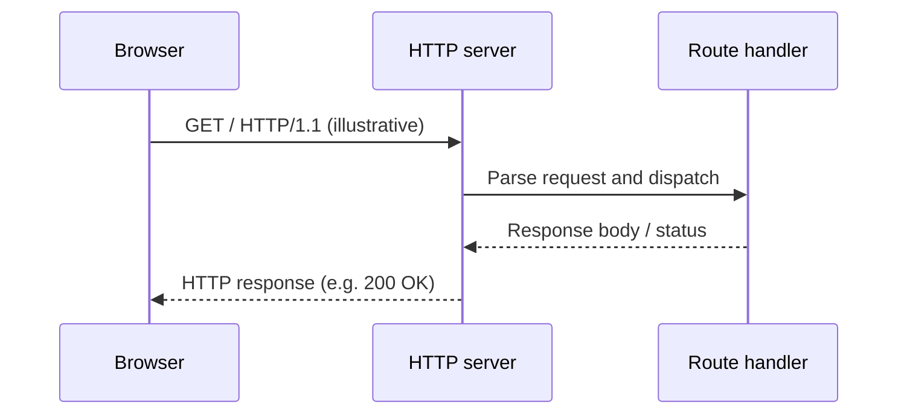

# 16 — Worked prototype: How an HTTP server handles a request

## What this sample is

An *original introductory educational scenario*, not a complete server tutorial and not a claim about the internals of every HTTP version. Illustration defaults to **HTTP/1.1-style request/response framing** to make the causal path visible. A real implementation may have TLS, proxies, connection reuse, HTTP/2 multiplexing, or HTTP/3 QUIC; show a simplification disclaimer.

## Learning objective

After watching, the viewer should be able to describe how a browser sends an HTTP request, how a server reads and routes it, and how a response is sent back. A future *build your own HTTP server* companion will implement a minimal parser/route/response example in Node.js and test it.

## Primary references to verify during production

- MDN HTTP overview: https://developer.mozilla.org/en-US/docs/Web/HTTP/Overview
- HTTP Semantics, RFC 9110: https://www.rfc-editor.org/rfc/rfc9110
- HTTP/1.1 message syntax, RFC 9112: https://www.rfc-editor.org/rfc/rfc9112
- Build Your Own X index: https://github.com/codecrafters-io/build-your-own-x

The test fixture source claims are marked `needs_human_review`. A real run must fetch and snapshot sources at an exact date before approval.

## Target narration and scene plan

| Scene | Est. seconds | Narration draft | Visual and cue |
|---|---:|---|---|
| 1: Hook | 0–5 | "You type a URL. What actually happens inside the server?" | Browser + address bar; camera zoom to a single request |
| 2: Request | 5–15 | "The browser sends an HTTP request describing what it wants, such as GET slash." | Moving request envelope; method and path fields revealed |
| 3: Arrival | 15–25 | "The server receives bytes and interprets the request according to the protocol." | Packets arrive at boundary; parser concept appears |
| 4: Route | 25–36 | "A route handler decides what content or action to return." | `GET /` follows matching branch; unmatched route optional |
| 5: Response | 36–49 | "The server sends a status, headers, and, when appropriate, a response body." | Response envelope labeled `200 OK` + sample content |
| 6: Conclusion | 49–59 | "That request–response cycle is the core idea. Real systems add many layers around it." | Reverse summary; mention omitted TLS/proxy/HTTP2 as small note |

Narration and durations are **drafts**. Final timing is measured from Kokoro audio, not forced into these second ranges.

## Conceptual diagram



## Scene registry mapping

- Scene 1: fixture `title-card` (`What happens inside an HTTP server?`, hook variant).
- Scenes 2–5: `BrowserRequestFlow` request, parse, route, response phases. The fixture's explicit progress/move cues are `send-request` and `return-response`; parse and route use their authored phase states.
- Scene 6: fixture `title-card` (`Request → Process → Response`, summary variant). The source fixture is preserved; overview is exercised in a separate validated gallery input, not substituted for its final scene.

A single Remotion component reused with **different `props`** demonstrates the intended animation engine. Later topic-specific components add queues, B-trees and Git graphs.

## Example local planning invocation

Phase 02 implements the offline silent path:

```bash
npm run studio -- render --script examples/http-server.videoscript.json --output output/http-server-review
```

This produces a 55-second/1650-frame silent preview from the saved preferred durations. It does not narrate, verify external sources, align captions or approve a release. The following planning/review/job commands remain future behavior:

```bash
studio plan --topic "How does an HTTP server handle a request?" --provider deepseek --max-api-usd 0.50
studio review facts --job <job-id>
studio render --job <job-id>
studio review video --job <job-id>
```

These commands are target behavior for the app to implement, not commands already executable from this documentation package.

Phase 03 also implements separate local narration:

```bash
npm run studio -- audio doctor --config narration.config.example.json
npm run studio -- audio smoke --config narration.config.example.json --script examples/http-server.videoscript.json --scene scene-02-request --output output/http-request-voice --allow-local-synthesis
```

With the identified local runtime/assets installed, this produces speech for the fixture's request scene. `HTTP` becomes `H T T P` and `URL` becomes `U R L` through the `tech-en-v1` lexicon; server/request/response use their ordinary pronunciations. These substitutions affect spoken text only. Saved draft durations and the original fixture remain unchanged. Use the mock config for model-free test tones; it does not test pronunciation. Voice quality remains under human review.

Phase 04 implements the saved-audio narrated preview:

```bash
npm run studio -- audio narrate --config narration.config.example.json --script examples/http-server.videoscript.json --output output/http-audio --allow-local-synthesis
npm run studio -- render --script examples/http-server.videoscript.json --narration output/http-audio --output output/http-preview --allow-caption-fallback
```

The current installed voice resolves to **1113 frames / 37.1 seconds**, including the fixture's authored minimum holds. Preferred estimates no longer determine narrated duration. Each scene has its own measured WAV; no equal scene/word timing is inferred. The explicit fallback shows the whole scene narration during detected speech and marks captions for review. Exact phrase cues require reviewed word timings; the unchanged fixture uses progress cues. Outputs include AAC speech, burned captions, SRT, measured timeline, artifact/implementation hashes and independent media QC. Play the complete video and check captions/voice clarity before accepting it; no release approval or publisher is included.

## Technical reviewer questions

- Is the narrative accurately scoped to HTTP/1.1-style framing and common server application logic?
- Does it accidentally present network packet boundaries as HTTP message boundaries?
- Is `GET /` an illustrative request and not a false statement about every URL?
- Is parsing vs routing shown as separate logical operations?
- Is an HTTP response illustrated with status/headers/body without implying every response has a body?
- Is TLS/HTTPS clearly out of scope rather than silently described incorrectly?

## Production acceptance

The same `BrowserRequestFlow` component must render scenes 2–5 with different parameters; Kokoro timings and packet cues agree; mobile-safe captions do not obscure the route; source notes and simplifications are included in release review. Render-only replay must not spend any DeepSeek tokens.

## Subsequent companion topic

*Build a tiny HTTP server in Node.js*: own source repo, verified unit tests for `GET /`, malformed requests, and explicit explanation that production-grade HTTP handling requires many other features. Short illustrates parsing/routing but links to runnable original code.
