# 18 — Future local Studio UX (P2, after CLI proves video quality)

## Purpose

A lightweight local web interface to manage source-backed ideas, inspect each scene, repair narration/animation, approve exact renders and upload deliberately. **Do not implement a dashboard to hide an unreliable renderer.**

## User flow

```mermaid
flowchart LR
    Board[Ideas backlog] --> New[New episode wizard]
    New --> Research[Sources + claims]
    Research --> Edit[Script / storyboard editor]
    Edit --> Preview[Timeline + scene preview]
    Preview --> QA[Review checklist]
    QA --> Export[Export / private publish]
    Export --> Results[Release history / analytics]
```

## Screens

### 1. Library / Ideas

Search/filter by series, source type, review status, topic; see last generated date, source credibility and animation component requirements. One-click **draft plan** (not publish).

### 2. Episode setup

Topic or GitHub URL, editorial profile, audience, target format/duration, model provider, per-episode API spend limit, language. Show source license/permission prompts upfront.

### 3. Evidence desk

Side-by-side source excerpt, claim, related scene/narration, `supported / uncertain / contradicted` toggle, reviewer note. URLs clickable; avoid embedding untrusted scripts in app preview.

### 4. Storyboard editor

Ordered scene cards with title, narration, animation component, props editor generated from Zod schema, timing preview and cue labels. Clearly distinguish `estimated` vs `measured` duration. Changes mark dirty assets and invalidate earlier release approvals.

### 5. Video preview / repair

Local video player, timeline scrubber, caption overlay and safe-zone guides. Rerender just selected scene. Download final MP4, SRT, cover and manifest; show source and media-rights checklist.

### 6. Release center

Fact reviewed? Rights reviewed? Video QA reviewed? Exact MP4 SHA256? Selected destination? Explicit privacy? Final title/description? Only then enable `Upload privately`. Keep `Schedule/public` distinct from private upload.

### 7. Activity / analytics (later)

Jobs, cost, per-stage timings, failed scenes, published private videos and measured platform analytics. Never display fabricated metrics for unavailable endpoints.

## UI design constraints

- Desktop-first editing with responsive mobile review.
- Keyboard-accessible scene selection, semantic status text and no color-only indicators.
- Local `127.0.0.1` binding by default; protect mutations against cross-site requests.
- Display secrets as configured/unconfigured only, never echo tokens.
- Progressive preview with clearly labeled missing assets; no pretend MP4/thumbnail.

## Minimal navigation

`Ideas · Episodes · Review · Releases · Settings`.

## MVP vs P2

MVP CLI already needs the same domain model and review state; the web Studio is a thin client of those services, **not an independent content-generation backend**.
